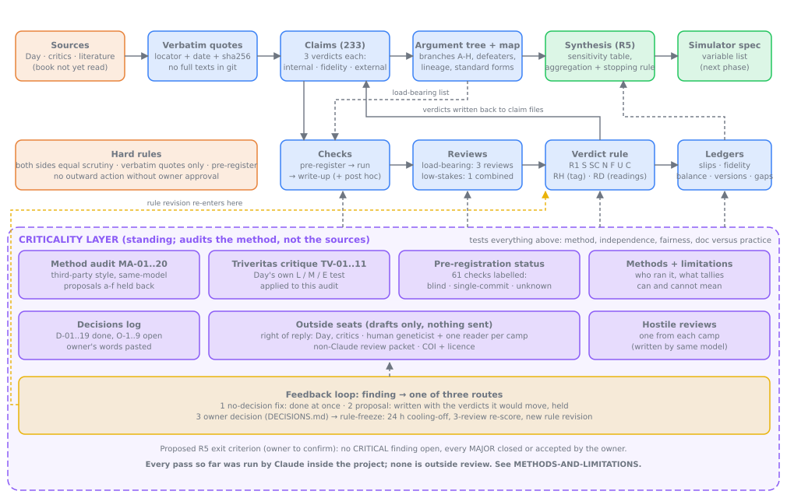
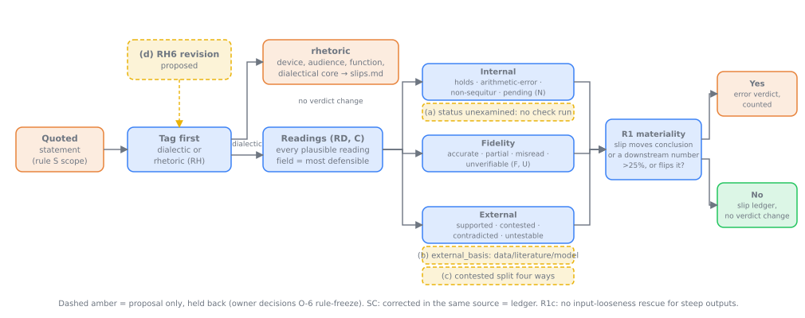

# Research: The Mathematical Case Against Evolution (Vox Day) and Its Critics

This is a neutral, two-sided audit of the mathematical claims in Vox Day's *Probability Zero* / MITTENS corpus and in the critiques written against it. The output is a sourced map of every claim, a numerical check of each equation, and a list of variables for a user-controllable simulator to be built later.

## How it fits together

<p align="center"></p>

Sources become verbatim quotes, quotes become claims with three verdicts, claims form the argument tree, checks test the load-bearing nodes, reviews and one verdict rule decide the verdicts, ledgers record slips and balance, and R5 synthesises. The criticality layer (`criticality/`) audits the method itself and feeds fixes, proposals and owner decisions back in. How one statement flows through the verdict rule: [`audit-verdict-logic.svg`](../img/audit-verdict-logic.svg). Everything outstanding, in order: [`ROADMAP.md`](ROADMAP.md).

<p align="center"></p>

## Rules
1. **Three verdicts per claim:**
   - **(a) Internal validity:** does the conclusion follow from the author's own assumptions?
   - **(b) Model fidelity:** does the cited theory or paper actually say that?
   - **(c) External validity:** are the assumptions biologically realistic?
2. **Both sides get equal scrutiny.** Arithmetic, sources and assumptions are audited for critics and allies just as for Day. Valid points from either side are recorded as prominently as errors.
3. **Verbatim quotes only.** Each quote needs a locator (URL plus paragraph, page or equation) and a source date or version. A claim known only through an opponent's quotation is tagged `secondhand`.
4. **Pre-register predictions.** Before a check runs, its claim file states what each side's model predicts.
5. **Numeric provenance.** Every number comes from `parameters.yaml`, from a cited quote, or is marked `derived:` with its formula.
6. **No question-begging.**
   - Forward simulations decide disputes about equilibrium. The coalescent (msprime) is used only for baselines.
   - Scaling (shrinking N and raising μ with θ held fixed) is validated before it is relied on.
7. **No full texts in git.** `sources/raw/` is gitignored. The repo commits links, archive URLs, short quotes and sha256 hashes.
8. **One verdict rule, applied to Day, critics and allies alike** (R4 X1, 2026-10-09; full text and test cases in [`R4-X1-verdict-rule.md`](../../research/checks/results/R4-X1-verdict-rule.md)):
- **R1 materiality:** a printed-number slip and an omitted-term slip are judged the same way; each is an error only if the correction moves the author's stated conclusion (on the author's own basis) or a downstream number in the same source by more than 25%, or flips it. Otherwise it goes to a slip ledger. R1c: no input-looseness rescue for steep outputs (tail probabilities, exponentials).
- **S scope:** only a claim's verbatim Statement quotes and its derivation are scored; slips in comments, replies, asides and captions go to the ledger on every side, unless the number carries an argument no node holds (then it gets its own node).
- **SC self-correction:** corrected in the same source = ledger; corrected in a later source = the quoted version is scored, with a note.
- **N non-sequitur:** the conclusion fails against the author's own table, equation or text, is circular, or overreaches; a contested premise is external, not internal (N1).
- **F fidelity:** an uncited non-standard input is `unverifiable` (never `partial`); standard values are exempt; human Nₑ ≈ 1e4 is contested-standard and flagged.
- **U unidentified authors:** relays and unidentified authors are not scored internal.
- **C charity:** the most charitable reading of an ambiguous referent is tried, and recorded, on every node.
- **RH rhetoric** (added 2026-10-09, user directive): Day knows rhetoric versus dialectic and uses it deliberately, so **rhetorical claims are handled rhetorically**. Tag each quoted statement `dialectic` (a truth claim or argument) or `rhetoric` (a boast, hyperbole, taunt or frame) before scoring it. Rhetoric is not literal-fact-checked: record its device, audience, function and any dialectical core in `ledgers/slips.md`. It changes no verdict. **Rhetoric is answered with better rhetoric:** a counter that is true, aimed at the move rather than the person, and that turns the audience back to the method or number. Applies to all sides, including critics' sneers.

## Layout
| Path | Contents |
|---|---|
| `glossary.md` | Pinned definitions. Most disputes here turn on definitions. |
| `parameters.yaml` | Numeric inputs, per side and per source version |
| `hierarchy.yaml`, `hierarchy/*.md` | The claim tree, as machine-readable YAML and as per-branch Mermaid diagrams |
| `claims/<ID>-<slug>.md` | One file per claim (see `claims/_TEMPLATE.md`) |
| `sources/bibliography.md` | Every source, with its access status |
| `opponents/<name>.md` | Each critic or ally, with their arguments mapped to claim IDs |
| `ledgers/` | Citation fidelity, side-by-side balance, contradictions, version drift |
| `../../research/checks/` | Throwaway verification code and `REVIEW.md` |
| `criticality/` | **Criticality layer**: the audit auditing itself (method audit MA-01 to MA-20 with status table, Triveritas critique TV-01 to TV-11, AMSTAR 2 and ROBIS appraisal AR-01 to AR-14 in `amstar2-robis-2026-10-12.md`, severe-testing pass ST-01 to ST-13 in `severe-testing-2026-10-12.md`, argument-structure pass AS-01 to AS-13 in `argument-structure-2026-10-12.md`, methods and limitations, proposals, standing procedure). Start at `criticality/README.md`. |
| `criticality/METHODS-AND-LIMITATIONS.md` | How the audit was done and what that method can and cannot support: who performs it, same-model reviews, pre-registration by kind, basis of external verdicts, what the tallies mean, sources not read. Read this before quoting any count. |
| `criticality/METHOD-AUDIT-2026-10-12.md` | Review of the method (findings MA-01 to MA-20) |
| `criticality/METHOD-AUDIT-proposals.md` | Specs for the audit's rule and vocabulary changes. **Proposals only, not applied.** |
| `ROADMAP.md` | Every outstanding item in one place: compute and checks, criticality remediation, owner decisions, outside inputs, path to R5 |
| `DECISIONS.md` | Dated log of owner decisions, reconstructed from committed evidence, and the decisions still open |
| `outreach/` | **Drafts only, nothing sent** (owner approval of text and channel required): right-of-reply letters (Day, critics), reviewer brief, non-Claude review packet, conflict-of-interest and licence draft |
| `../../research/checks/PREREG-STATUS.md` | Per check: registration commit, first results commit, gap, and a label (blind, criterion-only, reproduction, single-commit, unknown) |

## Status
| Stage | Status |
|---|---|
| R0 Scaffold | done |
| R1 Corpus harvest | **done** 2026-10-07: Day (154 posts, 32 Zenodo files, 75 quotes), literature (37 sources, 75+ quotes), critics/allies (48 rows, 132 quotes, 23 profiles) |
| R2 Claim extraction | **done** 2026-10-07: 193 claims (day 107, critic 46, ally 16, literature 24); lint clean |
| R3 Hierarchy | generated from claims (`hierarchy.yaml`, `hierarchy/branch-*.md`); 30 load-bearing nodes |
| R4 Math resolution | in progress: B0, B0.4, B1, B1b, B2a, B3, F1 done + reviewed (reviews #1–#3); B1c, B4a, B3b/B3c, C1, C1b, H, H2-hard, C2, F2, A-sim done + reviewed (review #4, 2026-10-08; 40 claim files updated). Remaining: E checks, G1/G3 (specific-vs-any), D sims, C1b call-depth follow-up, H at realistic human R with hard-selected load (plus T50 CIs), Yoo μ rescaling |
| R5 Synthesis | — |

## Running checks
```
python3 -m venv research/.venv && research/.venv/bin/pip install -r research/requirements.txt
research/.venv/bin/python -I research/checks/<file>.py
```
