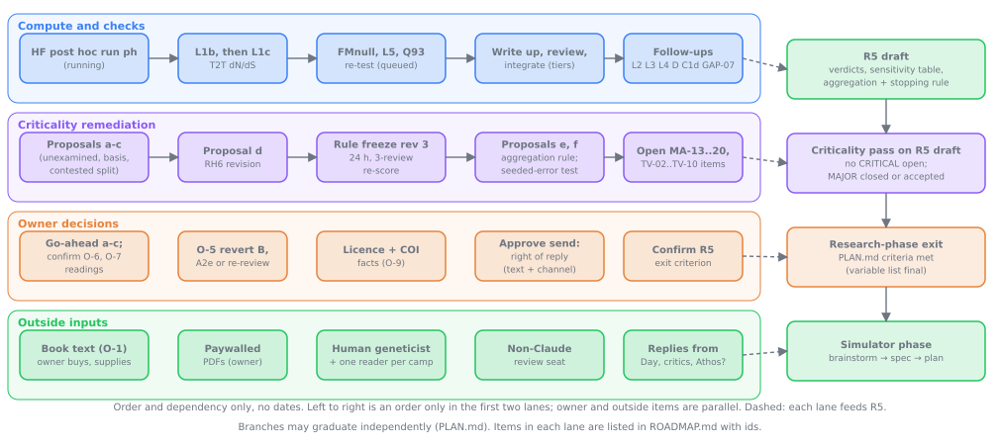

# Roadmap: everything outstanding

*Written 2026-10-12 at the owner's request ("plans or roadmap for the other suggestions and things tbd"). One table per area; each row is one open item with its source, status, blocker, next step, who acts and a rough cost. No dates: order and dependencies only. Sources of truth are linked in each section; when a row and its source disagree, the source wins and this file is wrong.*

**Status vocabulary.** `running` = a job is executing now. `queued` = specified and pre-registered (or ready to be), waiting on a named predecessor. `proposal` = written up in [`criticality/METHOD-AUDIT-proposals.md`](criticality/METHOD-AUDIT-proposals.md), held back, not applied. `needs owner` = only the owner can act. `tbd` = no spec, owner or blocker yet. `done` = shown only where an owner decision is recorded as applied.

**Who.** *owner* = Nick; *agent* = a Claude instance in the project's session; *outside* = a person or party not yet approached (nothing has been sent to anyone: hard rule 6). **Cost** is a rough guide: *tokens* = agent time (S/M/L), *CPU-h* = compute (free per the owner; tokens are the scarce resource), *owner min* = owner time.

**Where the plan sits.** Stages and exit criteria: [`PLAN.md`](PLAN.md). Method audit, Triveritas, AMSTAR 2 / ROBIS, severe-testing, argument-structure and certainty-of-evidence findings and their status, with a cross-pass synthesis: [`criticality/README.md`](criticality/README.md). Owner decisions: [`DECISIONS.md`](DECISIONS.md). Queue detail: [`research/checks/QUEUE.md`](../../research/checks/QUEUE.md).

---

## A. Compute and checks, in flight or queued

Source: `QUEUE.md`. Everything below is launched from na-workhorse or builder, never the workstation. Load-bearing checks get three reviews; low-stakes one combined review (AGENTS.md).

| id | Item | Source | Status | Blocker | Next step | Who | Cost |
|---|---|---|---|---|---|---|---|
| A1 | HF post hoc run `ph` (cap release, long burn, mix boundary, noisy truncation; 83 cells, 410 jobs). A host reboot lost shard `wh`; relaunched | QUEUE item 8 | running | CPU time (about 94 CPU-h left at the 2026-10-12 13:44 note) | Check once when due; merge on workhorse (`missing 0, extra 0, mismatches 0`); analyse; score against the docstring; fill the "pending post hoc" items; one combined review; integrate | agent | 94 CPU-h; tokens M |
| A2 | L1b: T2T rerun of the dN/dS check (L1). Closes MA-12 when it reports | QUEUE later queue; MA-12 | queued | Launch after A1 | First assign the two unclassified band regions in a pre-run note (ST-08). Launch the pre-registered `l1b_t2t_dnds.py`; collect; write up; three reviews | agent | CPU-h tens; tokens L |
| A3 | L1c: alignment method versus dN/dS ("protein-guided alignment gaps out divergent codons", Q180-Q186) | QUEUE later queue | queued | A1 and A2 (reads L1b's segment dump) | Launch after L1b; write up; three reviews | agent | CPU-h tens; tokens L |
| A4 | FMnull: neutral-null calibration of Day's "more than 80 times more variable" (FM3, Q164; FM10 premise) | QUEUE later queue (L4, mechanistic form) | queued | Launch after A1 | Launch pre-registered `fm_mesa_null.py`; write up; three reviews (load-bearing) | agent | CPU-h tens; tokens L |
| A5 | L5: aDNA zero-fixation power analysis (Day's statistics, four Holocene trajectories, three models) | QUEUE later queue; D-16 | queued | Launch after A1 | First record which of P2, P3 or P7 is expected to fail (ST-09). Launch pre-registered `l5_adna_power.py`; write up; one combined review (owner, D-16) | agent | CPU-h tens; tokens M |
| A6 | Q93 closeness re-test ("In any population over 10,000, neutral substitution will not fixate at all.") under the C7 standard and the 4N_e window; all readings, 3x band | QUEUE item 15 | queued | Pre-register first | Write and commit the script with predictions; run; one combined review | agent | trivial CPU; tokens S-M |
| A7 | Census-size source fetch. Named in the owner's brief; **no QUEUE entry or spec found** | brief 2026-10-12 | tbd | No spec | Owner or agent to say what is wanted (likely census N versus N_e inputs for B3, C7 and A6); then add to QUEUE | owner, then agent | tokens S |
| A8 | C1d follow-ups: transversion-restricted, SFS-matched neutral model; what the transition excess is | QUEUE next 5 | queued | Pre-registration; Holocene N_e not decided by the literature | Specify and pre-register | agent | CPU-h small; tokens M |
| A9 | D follow-ups: ProteinGym multi-mutant decay; noise null for the beneficial proxy; per-sequence prevalence (D10-D12) | QUEUE next 6 | queued | Public data fetch; Axe/Taylor full texts paywalled (D4) | Pre-register; run | agent | CPU-h small; tokens M-L |
| A10 | GAP-07 follow-ups: chimp-population polymorphism; a long-read SV set (T2T event counts are done, GAP-07t) | QUEUE next 7 | queued | Data availability | Fetch; pre-register; run | agent | CPU-h small; tokens M |
| A11 | L2: hardness h in humans (viability versus fertility; density dependence). h is the key unsourced H-branch parameter | QUEUE later queue; refresh 10b s6 | tbd | Full texts of Stearns 2010 and Byars 2010 (D4); no decomposition in the abstracts | Owner supplies texts, or agent searches OA cohort data | owner, agent | tokens M |
| A12 | L3: bias-corrected human-chimp alpha from MK with demographic correction | QUEUE later queue | tbd | Polymorphism data; Uricchio 2019 text is now in hand | Spec and pre-register. ST-03: this is the severe probe for A2e external (now resting on two relayed estimates); add planted-alpha simulations (alpha = 0 and 0.1 under human demography) as negative and positive controls, two estimators, and bands on the count (below 191, above 3 x 191, between) | agent | CPU-h small; tokens M |
| A13 | L4: FM overdispersion against a heterogeneity-aware null; pending Day's code or window size (FM10) | QUEUE later queue | tbd | Day's method not released; A4 is the mechanistic form | Wait on A4; revisit if Day releases | outside (Day), agent | tokens M |
| A14 | L-follow-ups: (a) CSAC 2005 text plus an independent ML dN/dS; (b) clade-level HMM states of Good 2017 (SI 5.2 is fetched: F absorbing by design) for E10; (c) Day's per-gene table when released (Q176) | QUEUE later queue; refresh 10b | tbd | (a) needs an ML estimator run; (c) needs Day's release | Pre-register (a); watch for (c) | agent | tokens S-M |
| A15 | E leftovers, GAP-03; XT follow-up (moved to A19 by ST-06) | QUEUE next 12; XT | tbd | No spec | Specify or drop (owner call) | owner, agent | tokens M |
| A16 | Sourced human beneficial DFE and M (none exists); H3 stays conditional until then | QUEUE item 8 | tbd | Literature gap | Look for a source; otherwise keep the bracket | agent | tokens S |
| A17 | Integration of HF after A1 (claim files, argmap, board, milestone post) | QUEUE item 8; AGENTS lifecycle step 6 | queued | A1 | One Sonnet agent at a time on shared files | agent | tokens M |
| A18 | Source refresh before each milestone post (HOWTO-refresh); material after 2026-10-12 is logged, not scored, under O-7 as read | `HOWTO-refresh.md`; O-7 | tbd | O-7 interpretation unconfirmed | Run one before the next post; log only | agent | tokens S |
| A19 | XT discordance: U-scaling rerun. fwdpy11 counts were 0.7% to 36% below numpy and theory, in step with the per-gamete mutation rate; cause not localised. Rerun the B1 equilibrium and cohort rows at four values of U with the same seeds; both outcomes named in advance (deficit vanishes as U falls: harness; persists: something else) | ST-06; `R4-XT.md` "Follow-up (not run)" | tbd | Pre-registration | Write and commit the script with predictions; run on na-workhorse; one combined review | agent | CPU-h small; tokens S-M |
| A20 | Data probe of the ancestral pipeline (B6 external `supported` rests on derivations that assume it): discordant site patterns among human, chimp and gorilla with an outgroup, from the alignments held for GAP-07b; bands for an empty and a full ancestral pipe; msprime with and without ancestral diversity through the same counting code as controls; reproduce the published discordance share | ST-03, ST-04; pass section 6 | tbd | Outgroup alignment fetch; pre-registration | Specify and pre-register | agent | CPU-h small; tokens M |
| A21 | Linked-site probe for G2c / B6c and overlap at human scale for F1b (all three external `supported` on runs whose falsifier could not fire): neutral sites on the same map as the sweeps; a short-map positive control where hitchhiking must cut diversity; compare with a published human diversity map | ST-02, ST-05; pass section 6 | tbd | Pre-registration; diversity map fetch | Specify and pre-register | agent | CPU-h tens; tokens M |
| A22 | Base-rate control for the B3 family reconstruction ("32.3 reconstructs only from base-pair totals", 8 of 480 grid cells): L7's random-target method applied to the B3 grid | ST-11 | tbd | Pre-registration | Write, pre-register, run locally (trivial) | agent | trivial CPU; tokens S |

---

## B. Criticality remediation

Source: [`criticality/README.md`](criticality/README.md) findings table and [`METHOD-AUDIT-proposals.md`](criticality/METHOD-AUDIT-proposals.md). Rule and vocabulary changes follow the rule-freeze procedure (O-6): written proposal naming the verdicts it moves, 24-hour cooling-off, three-review re-score of each load-bearing verdict moved, then a new rule revision. Findings whose blocker is an owner decision (MA-01, MA-03, MA-09, MA-10, MA-19) are carried in sections C and D and not repeated here. Triveritas-added items are B18 to B20. Items from the AMSTAR 2 and ROBIS appraisal ([`criticality/amstar2-robis-2026-10-12.md`](criticality/amstar2-robis-2026-10-12.md), findings AR-01 to AR-14) are B23 to B33; all but B32 change no rule, vocabulary or verdict.

| id | Item | Source | Status | Blocker | Next step | Who | Cost |
|---|---|---|---|---|---|---|---|
| B1 | Proposal (a): `unexamined` for `holds` nobody checked (6, 24, 36 or 58 internal `holds` move, by definition chosen) | MA-07 | proposal | Owner go-ahead (C10); rule-freeze | On go-ahead, apply with lint rule; re-score any load-bearing node moved | agent | tokens M |
| B2 | Proposal (b): `external_basis` field (data, literature, model); 52 decided external verdicts coded 16 data, 10 literature, 26 model (one coder, same model) | MA-05 | proposal | Owner go-ahead (C10) | Apply; second coder if an outside reader exists (D2) | agent | tokens M |
| B3 | Proposal (c): split `contested` four ways (all 114 re-coded; trial classification in the file) | MA-08 | proposal | Owner go-ahead (C10) | Apply; recount tallies | agent | tokens M-L |
| B4 | Proposal (d): RH6 revision (up to 7 RH tags re-decided; B, B9, C7 may move) | MA-02 | proposal | Owner decision; three-review re-score | Decide; re-score B, B9, C7 | owner, agent | tokens L |
| B5 | Proposal (e): ROOT aggregation rule and stopping rule (governs R5; moves no verdict) | MA-11 | proposal | O-7 interpretation; draft ahead of R5 | Confirm O-7; adopt before R5 draft | owner, agent | tokens S |
| B6 | Proposal (f): seeded-error test and blind re-derivation on five checks (D15, A2e, HF and others) | MA-01 | proposal | Planter and blind re-deriver should not be the integrating instance; ideally non-Claude (D3) | Run with the non-Claude seat, else same-model with that disclosed | agent, outside | tokens L |
| B7 | Stale "most charitable to Day" comments in C7 and B9; revert or re-review of B and A2e (O-5) | MA-03 | needs owner | O-5 (C5) | After O-5, fix the comments (no-decision fix) | agent | tokens S |
| B8 | Forward pre-registration rule (pushed timestamps, partitioning bands) not adopted | MA-04 | tbd | Owner choice | Decide whether to adopt for new checks | owner | owner min |
| B9 | MA-12 closure: DN1-DN3 verdicts are conditional on L1b | MA-12 | queued | A2 | Re-state verdicts when L1b reports | agent | tokens S |
| B10 | MA-13 mirror tree (one decomposition from the first summary pass) | MA-13 | tbd | No action yet | Decide whether to build a critic-drawn decomposition | agent | tokens L |
| B11 | MA-14 the 25% materiality line was set in the gap of observed slips | MA-14 | tbd | None | Sensitivity statement or leave disclosed | agent | tokens S |
| B12 | MA-15 category leaks (`side: audit` unspecified; A4 internal outside vocabulary passes lint) | MA-15 | tbd | None | Specify and tighten lint (a vocabulary change: follow O-6) | agent | tokens S |
| B13 | MA-16 from "the simulation shows" to hominids | MA-16 | tbd | Disclosed only | Add scoped wording where used | agent | tokens S |
| B14 | MA-17 presentation manufactures symmetry (partly touched by O-8) | MA-17 | tbd | None | Re-read front pages for symmetry cues | agent | tokens S |
| B15 | MA-18 budget decides depth (no mechanical tier test) | MA-18 | tbd | None | Specify a mechanical tier test | agent | tokens S |
| B16 | MA-19 residual: one-command quote verification not built | MA-19 | tbd | None | Build a script that checks every quote against saved text | agent | tokens M |
| B17 | MA-20 documents disagree with practice: residual items (README status table, totals off by one) not re-checked | MA-20 | tbd | None | Re-check after the next count refresh | agent | tokens S |
| B18 | Triveritas no-decision fixes: clause-provenance table for the verdict rule (TV-02); flip-value notes for the load-bearing verdicts where write-ups already have the numbers (TV-05); `versions.md` rows for the four Triveritas versions on evolution and `veriphysics.substack.com` on the refresh watch list (TV-09). Done by that pass: bibliography rows for the ten papers corrected | `triveritas-audit-2026-10-12.md` 7.2 | tbd | None; change no rule, vocabulary or verdict | Do at once, naming the TV ids in the commit | agent | tokens M |
| B19 | Triveritas proposals, held back: hold-out test of the frozen rule (TV-02); prediction and failure-threshold paragraphs for proposal f and the right-of-reply protocol (TV-03); conjunction flag per node, so the headline reads 14 of 233 not 131 `holds` (TV-06); `quantitative` field per claim (TV-07); `as_of` date per verdict (TV-10); a claim node for Day's Triveritas verdict on evolution (TV-09). Counts for the `quantitative` field not yet taken | `triveritas-audit-2026-10-12.md` 7.1, 7.2 | proposal | Rule-freeze procedure (C6); specify each with the counts it moves | Write specs in the proposals file before any is applied | agent | tokens L |
| B20 | Triveritas findings TV-01 to TV-11 (2 CRITICAL, 6 MAJOR, 1 MINOR to MAJOR, 2 MINOR); concordance with MA: agrees 11, in part 3, partly disagrees 3, not covered 6. TV-01 repeats MA-01; TV-11 (the application is itself not independent) stands until a rater outside this model family scores the audit | `triveritas-audit-2026-10-12.md` 5, 6 | needs owner | Outside rater (C4, C14, D3) | Register TV ids in the criticality README table; closure only by re-audit | owner, outside | tokens S |
| B21 | Closure by re-audit: no finding is closed in the sense of "re-audited and confirmed fixed" (0 of 20 MA, 0 of 11 TV) | criticality README | tbd | A pass by a reviewer who did not do the integration | Run a fresh pass when remediation is applied | agent, outside | tokens L |
| B22 | Record in the audit file any named outside reviewer (none recorded yet) | criticality README | tbd | D1-D3 | Record by name and role when one exists | agent | tokens S |
| B23 | Protocol amendment and deviations log: a dated amendment for the remaining work (eligibility, per-arm search, check-selection rule, synthesis rule) and `PROTOCOL-DEVIATIONS.md`, one row per departure from `PLAN.md` (review tiers, verdict rule and vocabulary, RH, RD, RH6, corpus following new posts, social media added, ten Zenodo records re-scoped, L5 tier, H4 dropped) with date, commit, reason, who decided, verdicts affected; superseded lines of `PLAN.md` marked; a paragraph on AR-01 in the methods page | AR-01, AR-02 | tbd | None for the log; the amendment's check-selection and synthesis rules follow the rule-freeze (C6); outside timestamp is C17 | Write the log first (no decision needed); draft the amendment | agent | tokens M |
| B24 | Consolidated excluded-sources list and PRISMA-style flow, generated by script from the harvest logs and bib files (`sources/EXCLUDED.md`, `sources/FLOW.md`): basis of each exclusion (full text, title, date, keyword scan), reason from a defined list; re-screen under rule RH the 8 posts excluded as "rhetoric" or "ai-rhetoric" on 2026-10-07. First-draft counts: 253 screened, 154 kept, 99 excluded, 72 pre-2019 not fetched; Zenodo 39, 11 set aside, 10 reversed | AR-07, AR-08 | tbd | None | Write the generator; publish both files; re-run at each refresh | agent | tokens S-M |
| B25 | Search log (`sources/SEARCH-LOG.md`): one row per search with date, endpoint, query, hits, new, kept, back-filled from the three harvest logs and the refresh files; a run-list for the 56 scripts in `research/tools/harvest/` | AR-06 | tbd | None | Back-fill; append at each refresh (add to `HOWTO-refresh.md`) | agent | tokens M |
| B26 | Per-arm search strategies written down; one critics search that does not start from Day's posts or the watch list (fixed query list on the book title, Zenodo DOIs and distinctive terms; every query logged with its hit count); a logged literature query for each load-bearing external verdict | AR-05 | tbd | Query list committed before the search is run; read-only (hard rule 6) | Commit the query list; run; log hits; propose additions in a refresh file | agent | tokens M |
| B27 | Second-screener sample: random 40 of the 99 excluded and 40 of the 154 kept blog posts (seed committed first), plus every exclusion made on a title alone; agreement reported; below 0.80, re-screen all. Same-model unless C18 or D3 | AR-03 | tbd | Seed and sample list committed first; an outside screener needs C18 | Run same-model, labelled as such; repeat with an outside screener when one exists | agent, outside | tokens M |
| B28 | Extraction: a `sources:` list of bib keys in claim front matter (schema addition, no verdict); completeness check on 20 random kept sources (every number and assertion has a claim or a stated reason for none); MA-09's blind re-extraction of 30 claim files | AR-04; MA-09 | tbd | One agent at a time on claim files; lint to accept the new field | Add the field by script; run the two samples with committed seeds | agent | tokens M-L |
| B29 | Eligibility text: one criterion each for Day's corpus, critics and allies, and literature; language; why 2019; why captions, comments and threads are admitted; the claim unit. Optional: read titles and first paragraphs of the 72 pre-2019 evolution-tag posts for an earlier form of the argument | AR-09 | tbd | Part of the amendment (B23) | Draft with B23 | agent | tokens S |
| B30 | An `interests` line per `opponents/` profile and for Day's venues (sales, paid subscriptions, employer, institutional ties), from fetched text only, "not stated" allowed, all sides at once, no inference drawn | AR-10 | tbd | None | Add in one commit covering every side | agent | tokens S |
| B31 | Coverage and check-selection table per milestone (side by branch by status by load-bearing); a paragraph on the likely direction of unread material; `status` fields brought up to date (B is `extracted` though re-scored). By the field as it stands: not checked Day 43%, critics 61%, allies 73%, literature 67%; 8 of 33 load-bearing at `extracted` | AR-11 | tbd | The written check-selection rule goes through B23 and the rule-freeze | Generate the table; fix `status`; write the paragraph | agent | tokens S-M |
| B32 | Extend proposal (e): mirror statements for the critics' thesis on each branch and a three-level confidence note per statement tied to `external_basis` and review tier; register before R5 | AR-12; MA-11, MA-13 | proposal | Not yet written into the proposals file; rule-freeze (C6); owner go-ahead (C10) | Write the extension into `METHOD-AUDIT-proposals.md` | agent, owner | tokens S |
| B33 | Residual contradictions: `README.md` l.256 "checked blind" against the methods page; stale review text in `PLAN.md` l.211-214; lagging `status` (with B31) | AR-14; MA-20 | tbd | None | Correct in the next integration commit | agent | tokens S |
| B34 | Pre-run notes for the queued checks: L1b's two unclassified band regions (ST-08); L5's P2 and P3 against P7 and the unreachable half of its DAY band (ST-09). Scripts unchanged; pointers are in `QUEUE.md` | ST-08, ST-09 | tbd | None; must precede A2 and A5 | One commit labelled "post hoc (pre-run, no data seen)" per check, or a note in `QUEUE.md` if no amendment is wanted | agent | tokens S |
| B35 | Proposal (g): a `severity` block per check inference (type, alternative, six capability codes, grade by rule, direction, reachability, rater) and a `best_probe` pointer beside each decided verdict; lint that the grade follows from the codes. Moves no verdict and no existing count; by this pass 13 verdict fields would show WEAK or BENT (a lower bound) | ST-01, ST-02, ST-12; pass section 10 | proposal | Owner go-ahead (C20); a second rater first (B39) | Write into `METHOD-AUDIT-proposals.md` as (g) | agent | tokens M |
| B36 | Proposal (h): every registered falsifier carries a reachability line (the setting or planted effect under which it fires) and the registration includes that run as a positive control; a run whose predictions are the registered arithmetic is filed as a derivation with no prediction score. Reword "All predictions met" for B5b, F1a and F1b when next touched | ST-05 | proposal | Owner go-ahead (C20) | Add to the check spec template in `research/README.md` on go-ahead | agent | tokens S |
| B37 | Reading probes for B internal, F1a internal and B9 internal: readers who have not seen the audit's readings, a registered agreement threshold, two control passages. Extends proposal (f2) | ST-03; MA-01, MA-03 | proposal | Outside or non-Claude readers (C3, C4); right of reply (C2) | Add the three passages to the f2 packet | agent, outside | tokens M |
| B38 | Write-up rules for the queued checks: FMnull leads with the empirical lineage-specificity and tree-incongruence statistics and prints each CRITIC class with its band width and the sourced share of it (ST-10); L1c runs one arm through a third-party aligner, or validates its stand-in against one on a sample, before DN6 moves | ST-10; pass section 7.3 | tbd | A3, A4 | Apply at write-up | agent | tokens S; CPU-h small |
| B39 | Severe-testing findings ST-01 to ST-13 (1 CRITICAL for the document's standing, 6 MAJOR, 6 MINOR); concordance: agrees 3, in part 4, new 6. ST-13 (one same-model rater, rubric written after the checks were read) stands until a second rater has applied the rubric to the same 57 rows without seeing the codes; registered prediction: fewer than a third of grades move by more than one step | [`criticality/severe-testing-2026-10-12.md`](criticality/severe-testing-2026-10-12.md) | needs owner | An outside or non-Claude rater (C3, C4); a same-model second rater in the meantime | Run the second-rater pass; report agreement per question | owner, outside, agent | tokens M |
| B40 | Presentation after ST-01, ST-06, ST-07: the methods-page sentence "count 10 checks as pre-registered tests" reworded to say what the 10 are; any "replicated in a second tool" statement in `README.md` or `HANDOFF.md` carries the XT exception (the methods page does since this pass); miss count per check printed in `RESULTS.md` from the scoring tables by script | ST-01, ST-06, ST-07 | tbd | None | Correct in the next integration commit | agent | tokens S |
| B41 | Comment wording for the ten audit arguments worded above their grounds: the external fields of A2e, B1c, B3, B3a, B3g, B6 and B7, the internal fields of B and F1a, and the B1 comment that outruns B4a. Add the kind of ground and its regime per the pass's table 9.3; no verdict value changes | AS-01, AS-08 | tbd | Owner go-ahead to edit claim-file comments (C22); rule-freeze if any verdict word changes | Draft the ten comment texts in one file for review, then apply in one commit | agent | tokens S |
| B42 | Proposal (i): a `warrant:` line and a `rebuttal conditions:` line beside each decided verdict on load-bearing claim files (74 fields; 29 have no comment at the field now), each naming a standing warrant and answering the non-circularity question; lint for presence only. Moves no verdict and no count | AS-02, AS-08; pass section 9.1 | proposal | Owner go-ahead (C22) | Add to the proposals file as (i); draft the lines for the 15 fully laid-out nodes first | agent | tokens M |
| B43 | Proposal (j): standing warrants SW-1 to SW-7 stated once (own basis, model to world, concession, literature as benchmark, default and burden, reading, materiality), each with what would make the audit drop it. SW-3 and SW-6 could move B3g external, A2e external and B internal | AS-01, AS-03, AS-04, AS-05; pass section 9.2 | proposal | Owner go-ahead (C22, C23); rule-freeze for SW-3 and SW-6 | Add to the proposals file as (j) with the verdicts each would move | agent | tokens S |
| B44 | Internal verdicts: name the rule-N clause at the field for A2e and F1a; add "inputs supplied by the audit: none / list" to internal comments on load-bearing nodes; for C2 say that the sensitivity paragraph cited is from version 1 of the paper | AS-05 | tbd | Owner go-ahead to edit claim-file comments (C22); owner if a value moves | List the supplied inputs for the five internal `non-sequitur` nodes | agent | tokens S |
| B45 | Mark opposing cases written by the audit at the node (ROOT-FM, FM10, H8, H2, H5, F3a); in any synthesis count the audit's 146 check-attacks as the audit's own standpoints. Goes with `side: audit` (B12) and the mirror statements (B32) | AS-06 | proposal | B12, B32 | Add the note field to the B12 specification | agent | tokens S |
| B46 | Smaller notes: "searched / not searched" wherever a claim file argues from absence (ROOT, ROOT-M, B3); a provenance sentence (notes on a source's nature never enter a verdict comment); a direction sub-label for `contested` (with B3); a `qualifier:` note per Statement quote (with B35) | AS-09, AS-10, AS-11, AS-12 | proposal | Owner go-ahead (C22); B3 and B35 for the last two | Add to the proposals file under (c) and (g) | agent | tokens S |
| B47 | Argument-structure findings AS-01 to AS-13 (1 CRITICAL for the document's standing, 7 MAJOR, 5 MINOR); concordance: agrees 6, in part 4, new 3. AS-13 (one same-model rater, three constructed schemes, primary books not obtained) stands until a second rater has applied sections 2.2 to 2.4 of the pass to the same 33 nodes without seeing the codes; registered expectation: the audit's hidden-warrant count and mismatch count each move by less than a third | [`criticality/argument-structure-2026-10-12.md`](criticality/argument-structure-2026-10-12.md) | needs owner | Outside or non-Claude rater (C3, C4, C24) | Prepare the packet: rubric, node list, blank code sheet | owner, outside | tokens M |
| B48 | Proposal (k): `external_certainty`, `external_direction`, `external_open` and the code line `external_grade` beside each decided external verdict, with lint L-GC1 to L-GC6 and a generated `research/checks/CERTAINTY.md`; M0 stored, the Day-side and critic-side mappings always printed beside it. Moves no verdict value. Absorbs proposal (b)'s field; replaces its "relabel" strength | GR-01, GR-02, GR-04, GR-05; pass section 8 | proposal | Owner decision (C25); B54 first | Apply to the 58 rated rows, then lint | agent | tokens M |
| B49 | Rate the remaining 114 decided external verdicts (35 `supported` or `contradicted`, about 75 `contested`, 4 `untestable`) by the revised adaptation | GR-01, GR-03; pass section 8.5 | tbd | B54 (rubric revision 2); C25 | Two sessions the size of the pass; `grade_certainty.py count` must report 0 mismatches | agent | tokens L |
| B50 | `contested` rows with no recorded evidence: record the evidence or move the field to `pending`. The 11 found: B2 (load-bearing), A4f, A4g, B2c, B4d, B4e, D13, G2g, ROOT-PG, B5f, G2f; an estimated 45 of 114 in all. Verdict values move | GR-03; proposals (a), (c) | proposal | Rule-freeze; decided with proposal (c) (C5) | B2 first: state what bears on the domain claim, or `pending` | agent, then owner | tokens M |
| B51 | Cite evidence already in the repository at the nodes whose external verdict rates lower without it: A2 (the LTEE table recounts E5 / E6 and L6), F1b (GAP-07c's measured polymorphic share), B5f (B5b), B6 (the published ancestral-polymorphism figure quoted in the FMnull registration). Add a "not run, and why" line per load-bearing claim | GR-10, GR-11 | tbd | Owner go-ahead to edit claim-file comments (C22) | Draft the four comment texts and the list in one file | agent | tokens S |
| B52 | A reason code on `untestable`: `not-measured`, `not-measurable`, `evaluative` (six verdicts; D7b is "not measured in the corpus") | GR-09 | proposal | Vocabulary change: rule-freeze | Specify with proposal (c)'s reason codes | agent | tokens S |
| B53 | B3 external: one field per k/mu value (N/N_e, 0.743, 0.5, 32.3, 800,000) in place of one `contradicted` over five; the per-site 32.3 leg rests on measured counts and would rate higher alone | GR-01 (row B3); AS-01 | proposal | Rule-freeze (a load-bearing verdict is restated) | Draft the five lines for review | agent, then owner | tokens S |
| B54 | Revision 2 of the certainty adaptation: fold in application notes N1 to N4 (start level against the `mw` tag; one fact, one domain; conditional rows and selection; the FR column), add a rule for conditional statements, then re-rate the 58 rows and report what moved | GR-07, GR-05 | tbd | None | Write the revision, commit it, re-rate in a second commit | agent | tokens M |
| B55 | Certainty-of-evidence findings GR-01 to GR-13 (1 CRITICAL for the document's standing, 5 MAJOR, 7 MINOR); concordance: agrees 16, in part 3, disagrees in part 4, refines 1, not covered 2. GR-13 (one same-model rater; GRADE's handbook does not promise reproducible judgements) stands until a second rater who is not of this model family has rated the same 58 rows without the codes; registered expectation: the same level on at least half the rated rows, within one level on at least 80%, and at least 6 of the 8 verdicts found over-stated under every mapping found over-stated again | [`criticality/grade-certainty-2026-10-12.md`](criticality/grade-certainty-2026-10-12.md) | needs owner | Outside or non-Claude rater (C3, C4, C26) | Prepare the packet: sections 2 and 4 notes, the 58 ids, a blank code sheet | owner, outside | tokens S |

---

## C. Owner decisions O-1 to O-9 and related

Source: [`DECISIONS.md`](DECISIONS.md), "Owner replies to O-1 to O-9" (the owner's words, 2026-10-12: "where buy pdf of prob zero? 1-4 we can get moving. 5 i dont get. 6-7 seem poltical an dits fine. 8 is fine? why? and 9 seems fine"). Status is the recorded state, not a guess.

| id | Item | Source | Status | Blocker | Next step | Who | Cost |
|---|---|---|---|---|---|---|---|
| C1 | O-1 buy *Probability Zero* and supply the text. Listings in `sources/bib-day.md` (grep `K-PZ`): Kindle ASIN B0GF8RQFY4; hardcover and signed edition listed sold out on 2026-10-07; **no PDF or DRM-free edition recorded**; no DRM bypass | MA-09; O-1 | needs owner | Purchase; **how the text is supplied** (legitimate export, scan of own copy, typed excerpts) | Owner buys and says how to supply; `secondhand` nodes are then re-sourced | owner | owner min; tokens M |
| C2 | O-2 right of reply to Day and each named critic (drafts exist; 21-day window suggested) | MA-10; `outreach/right-of-reply-*.md` | needs owner | Approval of exact text and **channel** per recipient; no contact channel recorded for Day; lifts hard rule 6 for this purpose only | Owner edits and approves, then sends or says who sends | owner | owner min |
| C3 | O-3 recruit a human population geneticist and one reader per camp | MA-01, MA-10; `outreach/reviewer-brief.md` | needs owner | Owner approves the brief; someone to approach | Owner picks and sends | owner | owner min |
| C4 | O-4 non-Claude review seat (packet drafted; seeded draw D15, A2e, HF) | MA-01; `outreach/non-claude-review-packet.md` | needs owner | No non-Claude model is installed here; owner must run the packet or give access | Owner runs or provides access | owner | owner min; tokens S |
| C5 | O-5 revert B (internal) and A2e (external) to `pending` or their pre-2026-10-11 values, or re-review. **Owner said he did not understand the question; an explanation was asked for** | MA-03 | needs owner | Explanation delivered; decision not made; B and A2e keep current values | Owner decides after reading the plain-language explanation | owner | owner min |
| C6 | O-6 verdict-rule freeze (rev 3) and 24-hour cooling-off. Accepted ("fine"). Interpretation (recorded for correction): the freeze starts once proposals a-c are applied or declined | MA-03, MA-10 | needs owner | Owner to confirm the reading | Confirm or correct the reading in `DECISIONS.md` | owner | owner min |
| C7 | O-7 corpus freeze at 2026-10-12, later material logged but not scored until R5 is drafted (except replies under C2 and releases a registered check awaits). Accepted; interpretation to confirm | MA-11 | needs owner | Owner to confirm the reading | Confirm or correct | owner | owner min |
| C8 | O-8 drop comparative error rates and Fisher p-values from public pages | MA-06 | done | None. Applied 2026-10-12 (`8b6f95b`); owner asked "why?", answered in `DECISIONS.md` | Revert with `git revert` if the owner wishes | owner | none |
| C9 | O-9 LICENSE and conflict-of-interest statement. Accepted in principle | MA-19; `outreach/coi-and-licence-draft.md` | needs owner | **Licence choice** and **COI facts** (who pays, relation to either camp, the project icon) in the owner's own words; no LICENSE file yet | Owner supplies both; agent adds LICENSE and fills the "Interests" paragraph | owner | owner min |
| C10 | Go-ahead for proposals (a), (b), (c) (the content of rule rev 3) | O-6; proposals file | needs owner | Owner go-ahead; C6 reading | Owner says apply, decline or amend each | owner | owner min |
| C11 | Confirm the proposed R5 exit criterion: no CRITICAL finding open, every MAJOR closed or accepted by the owner | PLAN.md l.229 | needs owner | Owner confirmation | Confirm, amend or reject | owner | owner min |
| C12 | Whether "Claude Athos" (the AI co-author credited on Day's Triveritas papers and in the audit's own same-family disclosure) is a separate recipient of the right of reply, or addressed only through Day | owner's brief; `METHODS-AND-LIMITATIONS.md` | tbd | No recorded decision; the draft letters name Day and critics only | Owner decides; agent adds or omits a draft | owner | owner min |
| C13 | Q157/Q158 RH tags and the four unclear tags (B9, C7, ROOT, ROOT-M) left for the owner in the RH pass; may be superseded by proposal (d) | QUEUE next 13; slips ledger | needs owner | Owner tagging or the RH6 revision (B4) | Decide, or fold into B4 | owner | owner min |
| C14 | O-10 (proposed by the Triveritas pass; **not yet in `DECISIONS.md`**): send the Triveritas packet to non-Claude raters (named in the pass: Grok, Gemini) under its rater rules (composing model excluded, one family per leg, human blind first). Same authorisation as O-4 with a second packet | TV-01, TV-11 | needs owner | Owner approval; no packet text exists beyond the pass's section 7 | Owner approves; agent adds the entry to `DECISIONS.md` and drafts the packet | owner | owner min; tokens M |
| C15 | O-11 (proposed, not yet recorded): include the Triveritas result in the right-of-reply letter to Day and invite him to score the audit with his own tool. Needs hard rule 6 lifted as for C2 | TV-11 | needs owner | C2 | Owner decides with C2 | owner | owner min |
| C16 | O-12 (proposed, not yet recorded): keep the Triveritas as a standing lens of the criticality layer (re-run at each pass, by an outside rater when one exists) or treat it as a one-off | TV pass 7.2 | needs owner | Owner choice | Decide; if standing, add to the standing procedure | owner | owner min |
| C17 | O-13 (proposed by the AMSTAR 2 and ROBIS pass; **not yet in `DECISIONS.md`**): give the amended protocol and the R5 synthesis rule an outside timestamp before R5 (a deposit or registry entry). An outward action under hard rule 6 | AR-01 | needs owner | B23 drafted; owner approval of where and what | Owner decides; agent prepares the frozen text | owner | owner min |
| C18 | O-14 (proposed, not yet recorded): extend the outside seats of C3 and C4 to a second screener and extractor for the B27 and B28 samples, and to an outside appraiser who re-applies AMSTAR 2 and ROBIS from the fetched texts, ratings printed beside this pass's | AR-03, AR-04, AR-13 | needs owner | C3, C4 | Owner decides with C3 and C4; agent drafts the packet | owner | owner min; tokens S |
| C19 | O-15 (proposed, not yet recorded): keep AMSTAR 2 and ROBIS as a standing lens, re-applied to the R5 draft, or treat the pass as a one-off | AR pass section 11 | needs owner | Owner choice | Decide; if standing, add to the standing procedure | owner | owner min |
| C20 | O-16 (proposed by the severe-testing pass; **not yet in `DECISIONS.md`**): keep severity as a standing lens of the criticality layer and adopt the `severity` field (B35) and the reachability line (B36), or treat the pass as a one-off | ST-01, ST-05; pass sections 10, 11 | needs owner | Owner choice | Decide; if standing, add to the standing procedure and apply B35, B36 | owner | owner min 5 |
| C21 | O-17 (proposed, not yet recorded): for B internal, A2e external, F1a internal and B6 external, whose deciding probes are WEAK or BENT, leave the present values with a "weak probe" note, or return them to `pending` / `contested` until a severe probe has run (A12, A20, B37). Related to O-5 (C5) | ST-03 | needs owner | Owner choice; rule-freeze if values move | Decide with C5 | owner | owner min 10 |
| C22 | O-18 (proposed by the argument-structure pass; **not yet in `DECISIONS.md`**): adopt the comment wording (B41), the `warrant:` and `rebuttal conditions:` lines (B42) and the standing warrants (B43), or treat the pass as a one-off | AS-01, AS-02; pass sections 9, 12 | needs owner | Owner choice | Decide; if adopted, apply B41 and B44, then B42 | owner | owner min 10 |
| C23 | O-19 (proposed, not yet recorded): may an author's concession decide an external verdict? If not, B3g external and the concession clauses in B3, B3a, B1c and B6 are argued again on evidence, under the rule-freeze | AS-03 | needs owner | Owner choice; rule-freeze if values move | Decide with C5 and C21 | owner | owner min 10 |
| C24 | O-20 and O-21 (proposed, not yet recorded): add to the right-of-reply packet the two reading questions (A2e: a count of adaptive fixations, or total throughput; B: which sense of "nearly empty") and the closure rule of the pass's section 9.4; appoint a second rater for the pass (B47) | AS-04, AS-07, AS-13 | needs owner | C2 (right of reply), C3, C4 | Agent drafts the two questions and the closure rule; owner decides | owner, agent | owner min; tokens S |
| C25 | O-22 (proposed by the certainty-of-evidence pass; **not yet in `DECISIONS.md`**): adopt certainty and direction beside the external verdict (B48), or treat the pass as a one-off; if adopted, which starting-level mapping is stored and whether all three are always printed. Decide with proposals (b) and (c), which it partly absorbs | GR-01, GR-02; pass sections 2.4, 8 | needs owner | Owner choice | Decide; if adopted, B54, then B48 and B49 | owner | owner min 15 |
| C26 | O-23 (proposed, not yet recorded): a second rater for the 58 rows who is not of this model family (B55), with the second raters asked for by ST-13 and AS-13 | GR-13 | needs owner | C3, C4 | Agent prepares the packet; owner decides who | owner, outside | owner min; tokens S |

---

## D. Outside inputs

Nothing here has been requested. Each item needs a prior owner approval in section C.

| id | Item | Source | Status | Blocker | Next step | Who | Cost |
|---|---|---|---|---|---|---|---|
| D1 | Human population geneticist on the five checks that carry the most: B3/B7 (k = mu), B4a (ancestral polymorphism), H8/HF (cost of selection), A2e, GAP-07 counts | O-3; MA-01 | tbd | C3 | Recruit; their view recorded in a separate section of the audit file | outside | owner min; their time |
| D2 | One reader from each camp as adversarial collaborators on the rule text and load-bearing list; disagreement recorded, not resolved by the owner | O-3; MA-10 | tbd | C3 | Recruit | outside | their time |
| D3 | Non-Claude model for one review seat on load-bearing checks (also runs B6, and the Triveritas packet if C14 is approved) | O-4; MA-01 | tbd | C4 | Run packet; record family and version | owner, outside | tokens S |
| D4 | Paywalled or blocked full texts for the owner to supply: Bakewell 2007 (PNAS); Byars 2010 (PNAS, free); Stearns 2010 (Nat Rev Genet); Eyre-Walker 2006; Huber 2017; Zoonomia 2023 (Science); a sourced noncoding DFE (e.g. a conserved-noncoding DFE paper); an independent genome-wide human-chimp dN/dS; Hodgkinson and Eyre-Walker 2011 (Nat Rev Genet); Hwang and Green 2004 (bot challenge); Axe 2004, Keefe-Szostak 2001, Taylor 2001 (abstracts only). No bypass | `refresh-2026-10-11b-lit.md` "Needs the owner"; `refresh-2026-10-12c-lit.md`; `refresh-2026-10-10b.md` | needs owner | Owner obtains legitimate copies | Owner supplies files into a new `sources/raw/` directory (gitignored) | owner | owner min |
| D5 | Day's replies and releases: right-of-reply answer; FM10 method and window size; per-gene table (Q176); any code | C2; A13; A14 | tbd | C2; Day's choice | Watch the refresh log; score only what O-7 allows | outside | none |
| D6 | Critics' replies (McCarthy, Mansfield, Hancock and others) | C2 | tbd | C2 | As D5 | outside | none |

---

## E. Path to R5 and the simulator phase

Exit criteria (from `PLAN.md` "Exit the research phase when"): every load-bearing claim has a reviewed check and three verdicts; every critic and ally argument is mapped; the gap list is closed or recorded as inaccessible; the variable list is final; and, proposed, a criticality pass on the R5 draft with no CRITICAL finding open and every MAJOR closed or owner-accepted. Branches may graduate independently.

1. **Finish and integrate the compute in A** (A1 first; then A2 to A6 as they launch). Exit: each load-bearing node has a reviewed check; HF verdicts integrated.
2. **Owner decisions that unblock the rest** (C5, C6, C7, C10, C11; C1 and C9 in parallel). Exit: each recorded in `DECISIONS.md` with the owner's words.
3. **Apply proposals a-c, and d if chosen, under the rule freeze** (B1-B4): cooling-off, three-review re-score of every load-bearing verdict moved, new rule revision.
4. **Outside seats, if approved** (C2-C4, D1-D3): send; record replies verbatim; run B6.
5. **Close or accept every CRITICAL and MAJOR finding** (section B and the five owner-blocked ones). Exit: the register in `criticality/README.md` shows none open, or the owner's acceptance in `DECISIONS.md`.
6. **Draft R5** (`R5-draft.md`): verdicts per branch, balance ledger, sensitivity table that becomes the simulator variable list (N, N_e, mu, L, s distribution, dominance, recombination, generation time, start state, demography, T, divergence-counting rule, mutator alleles), using the ROOT aggregation and stopping rule (B5).
7. **Criticality pass on the R5 draft**, by a reviewer who did not integrate it, with its findings kept in their own section (and the Triveritas critique re-run on the R5 text). Exit: criterion in step 5 met on the draft.
8. **Exit the research phase, then the simulator phase:** brainstorming, spec, plan. No simulator code before step 7 (AGENTS.md).

---

## Counts

Rows by section and status (counted from the tables above on 2026-10-12; section E is a sequence, not rows).

| Section | Rows | running | queued | proposal | needs owner | tbd | done |
|---|---|---|---|---|---|---|---|
| A | 22 | 1 | 9 | 0 | 0 | 12 | 0 |
| B | 55 | 0 | 1 | 19 | 5 | 30 | 0 |
| C | 26 | 0 | 0 | 0 | 24 | 1 | 1 |
| D | 6 | 0 | 0 | 0 | 1 | 5 | 0 |
| **All** | **109** | 1 | 10 | 19 | 30 | 48 | 1 |

Needs-owner rows (30): B7, B20, B39, B47, B55, C1, C2, C3, C4, C5, C6, C7, C9, C10, C11, C13, C14, C15, C16, C17, C18, C19, C20, C21, C22, C23, C24, C25, C26, D4.

*2026-10-12, later the same day: 14 rows added by the AMSTAR 2 and ROBIS appraisal (B23 to B33, C17 to C19). The roadmap figure `audit-roadmap.svg` was not regenerated and does not show them.*

*2026-10-12, later again: 13 rows added by the severe-testing pass (A19 to A22, B34 to B40, C20, C21); A2, A5, A12 and A15 amended to point at them. The figure was not regenerated.*

*2026-10-12, later still: 10 rows added by the argument-structure pass (B41 to B47, C22 to C24). The figure was not regenerated.*

*2026-10-12, last: 10 rows added by the certainty-of-evidence pass (B48 to B55, C25, C26). The figure was not regenerated.*
