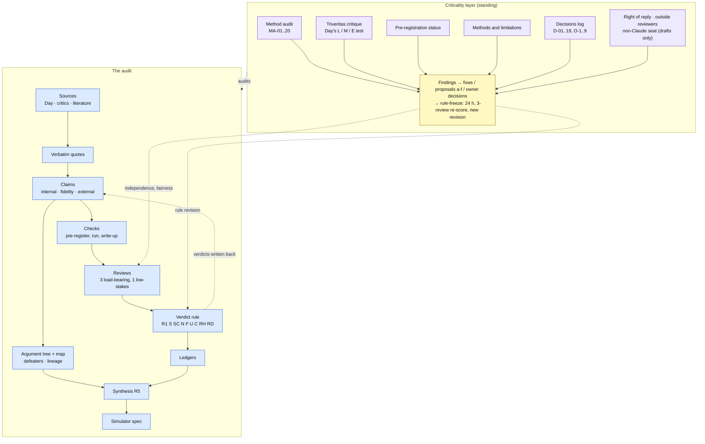

# Criticality layer: the audit auditing itself

*Created 2026-10-12 at the owner's request ("add all this as a 'criticality layer'"). Standing layer, not a one-off.*

**What it is.** The per-check reviews (`research/checks/REVIEW.md`) test the maths of one check. The criticality layer tests everything around the maths: the method, the logic of the verdict rules, the epistemology of what a verdict can claim, the independence of the reviewers, the fairness of the two-sided treatment, and the gap between what the documents say and what was done. It produces findings about the project, not about Day or his critics. Its output is tracked to closure like any other work item.

**Who runs it, stated plainly.** Every pass so far was run by a Claude instance inside the project's own session, under one owner. It is therefore not independent, whatever it is called (the first audit says so itself, MA-01 and its preface). A pass counts as outside review only if the dated audit file records a named reviewer who is not the project's model family or not the project's owner. None is recorded yet.

## Where it sits in the audit (compact diagram)

The full figure is [`docs/img/audit-systems.svg`](../../img/audit-systems.svg); the verdict logic is [`docs/img/audit-verdict-logic.svg`](../../img/audit-verdict-logic.svg); outstanding work is in [`../ROADMAP.md`](../ROADMAP.md).

## Components

| # | Component | File | Status (2026-10-12) |
|---|---|---|---|
| i | Third-party-style method audit, findings MA-01 to MA-20 | [`METHOD-AUDIT-2026-10-12.md`](METHOD-AUDIT-2026-10-12.md); proposals: [`METHOD-AUDIT-proposals.md`](METHOD-AUDIT-proposals.md) | Done; remediation partly applied (table below) |
| ii | Triveritas critique: the audit assessed with Vox Day's own "Triveritas" system | [`triveritas-method.md`](triveritas-method.md) (what it is, versions, assessment), [`triveritas-audit-2026-10-12.md`](triveritas-audit-2026-10-12.md) (application; findings TV-01 to TV-11) | Done 2026-10-12; no verdict, rule or claim changed; same-model, not blind (TV-11) |
| iii | Pre-registration status of every registered check | [`research/checks/PREREG-STATUS.md`](../../../research/checks/PREREG-STATUS.md) (generated by `research/tools/prereg_status.py`) | Done; 61 rows: blind 10, criterion-only 6, reproduction 3, single-commit 18, unknown 20, registered-not-run 4 |
| iv | Methods and limitations (publishable page) | [`METHODS-AND-LIMITATIONS.md`](METHODS-AND-LIMITATIONS.md) | Written; not yet linked from the repo front page beyond the READMEs; interests paragraph waits on O-9 |
| v | Owner decisions log and open decisions | [`../DECISIONS.md`](../DECISIONS.md) | Started; D-01 to D-19, O-1 to O-9 |
| vi | Outreach: right of reply, outside human reviewers, non-Claude review seat, COI and licence | [`../outreach/`](../outreach/) | Drafts only. Nothing sent; nobody approached (hard rule 6) |
| vii | Hostile reviews (one from a sharp reader on Day's side, one from a sharp evolutionary biologist who thinks the audit grants Day too much) | Section "Hostile reviews" of [`METHOD-AUDIT-2026-10-12.md`](METHOD-AUDIT-2026-10-12.md) | Done, written by the same model; both answered in the "unfair criticisms" section there |

## Findings of the 2026-10-12 method audit and their status

Status key: **remediated** = the fix that changes no rule, vocabulary or verdict is done; **proposal** = specified in `METHOD-AUDIT-proposals.md`, not applied; **needs owner** = only the owner can act (see `DECISIONS.md`); **open** = no action yet. Where a finding has parts in several states, the status shown is that of the part that still blocks closure, and the note gives the rest. Evidence: commits since `640aafa`, `DECISIONS.md`, the proposals file.

| ID | Severity | Finding | Status | Note |
|---|---|---|---|---|
| MA-01 | CRITICAL | Three reviews are three prompts to one reviewer | needs owner | HANDOFF tier statement corrected (`255c9b8`). Seeded-error test and blind re-derivation specified (proposal f), not run. Non-Claude seat and human geneticist: O-3, O-4, packets drafted |
| MA-02 | MAJOR | RH6 rewards distance from the truth | proposal | Proposal d |
| MA-03 | MAJOR | Rules remade on the day they decided verdicts | needs owner | `DECISIONS.md` started (`22488c0`). Revert of B internal and A2e external to pre-10-11 values or re-review: O-5, owner asked for an explanation. Stale "most charitable to Day" comments in C7 and B9 still present |
| MA-04 | MAJOR | Pre-registration unverifiable or empty for many checks | remediated | Descriptive labels (`a15b294`). Forward rule (pushed timestamps, partitioning bands) not adopted |
| MA-05 | MAJOR | "External" often decided by the disputed theory | proposal | Proposal b: 52 decided external verdicts coded 16 data, 10 literature, 26 model; no load-bearing external verdict rests on data the audit processed |
| MA-06 | MAJOR | Day-versus-critics error rate does not measure what it appears to | remediated | Rates and Fisher p-values removed from public pages (O-8, `8b6f95b`) |
| MA-07 | MAJOR | `holds` is the default | proposal | Proposal a: 6, 24, 36 or 58 internal `holds` become `unexamined`, by definition chosen |
| MA-08 | MAJOR | `contested` holds five different things | proposal | Proposal c: all 114 `contested` re-coded |
| MA-09 | MAJOR | The audited book has not been read | needs owner | O-1: owner will purchase; no PDF listing found; no DRM bypass |
| MA-10 | MAJOR | No one outside the loop has been asked anything | needs owner | O-2, O-3: drafts in `outreach/`; send needs approval of exact text and channel |
| MA-11 | MAJOR | No aggregation rule and no stopping rule | proposal | Proposal e; O-7 corpus freeze accepted by owner ("fine"), interpretation to be confirmed |
| MA-12 | MINOR to MAJOR | Verdicts ran ahead of the like-for-like test | remediated | DN1-DN3 comments marked conditional on L1b (`f3a1790`); closes fully when L1b reports |
| MA-13 | MINOR | One decomposition from the first summary pass | open | Mirror tree not built |
| MA-14 | MINOR | The 25% line was set in the gap of observed slips | open | No action |
| MA-15 | MINOR | Category leaks in the three-verdict scheme | open | `side: audit` not specified; `A4` internal outside vocabulary passes lint |
| MA-16 | MINOR | From "the simulation shows" to hominids | open | Disclosed; no change |
| MA-17 | MINOR | Presentation manufactures symmetry | open | Partly touched by the MA-06 removals |
| MA-18 | MINOR | Budget decides depth | open | Mechanical tier test not specified |
| MA-19 | MINOR each, together MAJOR | What is missing | needs owner | Methods and limitations page written (`e17e5c0`). LICENSE and COI: O-9, drafts only. One-command quote verification not built |
| MA-20 | COSMETIC | Documents disagree with practice | open | HANDOFF and AGENTS items fixed (`255c9b8`); residual items (stale comments, README status table, totals off by one) not re-checked |

**Counts by status (20 findings):** remediated 3 (MA-04, MA-06, MA-12); proposal 5 (MA-02, MA-05, MA-07, MA-08, MA-11); needs owner 5 (MA-01, MA-03, MA-09, MA-10, MA-19); open 7 (MA-13 to MA-18, MA-20). **By severity:** CRITICAL 1, MAJOR 10, MINOR to MAJOR 1, MINOR 7 (MA-13 to MA-19, MA-19 also "together MAJOR"), COSMETIC 1. No finding is closed in the sense of "re-audited and confirmed fixed".

## The Triveritas critique: what it is and what it found

**What it is.** Day's own critique system, published with the listed co-author "Claude Athos" in February and March 2026: "The Triveritas holds that a claim merits warranted assent if and only if it satisfies three jointly necessary conditions: logical validity (L), mathematical coherence (M), and empirical anchoring (E)." (Q203, [`quotes-day.md`](../sources/quotes-day.md)). He uses it to pass or fail theories, papers and other people's arguments, first as three pass/fail tests and later as 0 to 100 scores. Each leg exists in three versions in his texts, with three different pass marks (50, 60, 90).

**How it is applied here.** As a lens, not a re-score: each leg is applied to the audit's method under every version Day gave (readings a, b, c), to seven sample verdicts (B, A2e, C7, DN6, B5c, G2e, H8) with the Day and critic claim beside each, and to the two top-level positions (Day's root claim and the critics' positive thesis). Day's own protocol says the authors do not score their own work (Q224); this pass is by the same model family as the audited work, was not blind, and breaks that rule (TV-11). It covers logic, mathematics and empirical anchoring only; fidelity to sources, fairness to named people, conflicts of interest and presentation are outside it.

**Headline result.** By Day's rule a failure on any leg withholds assent, and the audit's tallies and self-descriptions do not yet merit it: the weakest leg is E in the sense of independence ("observations the claimant does not control", Q212), the same place MA-01 sits. L-b fails (the verdict rule is a growing set of case-driven clauses, TV-02); M-c fails (thresholds are free parameters and no function leads from node verdicts to a conclusion, TV-05). Same readings, same test: Day's root claim and the critics' positive thesis also fail the conjunction as things stand, each most clearly on E. Credited as sound: quote handling machine-checked against hashed text, the checks that processed public data, the pre-registered long runs that report misses, and leaving a verdict `pending` until a like-for-like test exists.

| ID | Severity | Finding (short) | Concordance with MA |
|---|---|---|---|
| TV-01 | CRITICAL | By Day's corollary the audit is self-sealing in practice (every confirming act is by the party whose claim it confirms) | agrees with MA-01 |
| TV-02 | MAJOR | The verdict rule is a set of accommodations with no overfitting test | new as a whole; MA-02, MA-03, MA-14 found parts |
| TV-03 | MAJOR | The audit has made no prediction about itself that could fail | new |
| TV-04 | MAJOR | Load-bearing external verdicts are mathematics without anchoring, the fault Day charges to a critic | agrees with MA-05, MA-16 |
| TV-05 | MAJOR | Thresholds are free parameters; the multiplicative band is undefined where used | agrees with MA-02, MA-14 |
| TV-06 | MAJOR | Three columns allow the trade-off the Triveritas forbids | partly disagrees with the method audit's defence of column-wise reporting |
| TV-07 | MINOR to MAJOR | Claims without mathematics pass by default | new remedy for MA-06, MA-07 |
| TV-08 | MAJOR | No rhetoric exemption in the Triveritas; RH6 and the Triveritas conflict | agrees with MA-02 |
| TV-09 | MINOR | Day's Triveritas claims about evolution are in the corpus and unaudited | new |
| TV-10 | MINOR | Verdicts carry no as-of date | new |
| TV-11 | CRITICAL for the standing of the document | This application is itself outside Day's protocol (same family, not blind) | independence, as MA-01 |

**Concordance counts** (the Triveritas pass's own tally of the 20 MA findings; some appear in two groups): agrees 11, agrees in part 3, partly disagrees 3 (MA-05 remedy 2, MA-08, and the column-wise defence under MA-07), not covered or only touched 6 (MA-06 beyond the statistic, MA-17, MA-18, part of MA-19, the fairness half of MA-10, the mechanics of MA-04). What the method audit found that the Triveritas cannot see: fidelity, fairness to named people, conflicts of interest, presentation, budget. No TV finding is closed. Remediation (no-decision fixes, proposals, proposed owner decisions O-10 to O-12, which are not yet in `DECISIONS.md`) is in section 7 of the audit file and rows B18 to B20 and C14 to C16 of [`../ROADMAP.md`](../ROADMAP.md).

## Standing procedure

**When a pass is run.**
1. Before each milestone post.
2. Before R5 is drafted (and again on the R5 draft before release).
3. After any change to a verdict rule, the verdict vocabulary, the review tiers or the load-bearing list.
4. When an outside reviewer's or author's reply arrives, for the findings it bears on.

**Who or what runs it.** A reviewer with no part in the checks under review, and not the instance that integrated them. Until an outside reviewer is recorded this means a fresh same-model instance, and the audit file must say so in its first paragraph. A non-Claude or human reviewer, when one is authorised (O-3, O-4), is recorded by name and role in the file and its findings are kept in a separate section so that agreement and disagreement with the same-model pass can be seen.

**What it must produce.**
- A dated file `docs/research/criticality/<name>-YYYY-MM-DD.md` with an executive summary of what is sound and what is not.
- Findings with ids (continue the series: `MA-21...` for method audits; a new prefix per method, e.g. `TV-` for Triveritas), a severity (CRITICAL, MAJOR, MINOR, COSMETIC), a category, evidence with locators, and a remedy.
- A concordance with earlier passes: which findings repeat, which are new, which earlier findings are now closed, and which earlier findings the new pass disagrees with.
- Remediation split three ways: **no-decision fixes** (change no rule, vocabulary or verdict; do at once), **proposals** (specified with the verdicts and counts they would move, held back), **owner decisions** (added to `DECISIONS.md` as open items).
- Both sides' view of each finding: whom it helps, as the proposals file does.

**Tracking to closure.** The findings table in this README is the register. A finding is **closed** only when a later pass (or an outside reviewer) has checked the fix and said so; until then it stays remediated, proposal, needs owner, or open. Each commit that acts on a finding names the id. Owner decisions are logged in `DECISIONS.md` with the owner's own words pasted, dated. The status board carries counts and the CRITICAL and MAJOR list.

**Rule and vocabulary changes arising from a pass** follow the rule-freeze procedure in `DECISIONS.md` (O-6, accepted by the owner, interpretation pending his correction): a written proposal naming the verdicts it would move; no integration on the day it is proposed (24-hour cooling-off); a three-review re-score of every load-bearing verdict it moves; then a new rule revision number. Fixes that touch no rule, vocabulary or verdict are not held back.

**Proposed for the research-phase exit (owner to confirm):** no CRITICAL finding stands open, and every MAJOR finding is closed or explicitly accepted by the owner in `DECISIONS.md`. See `PLAN.md`.
