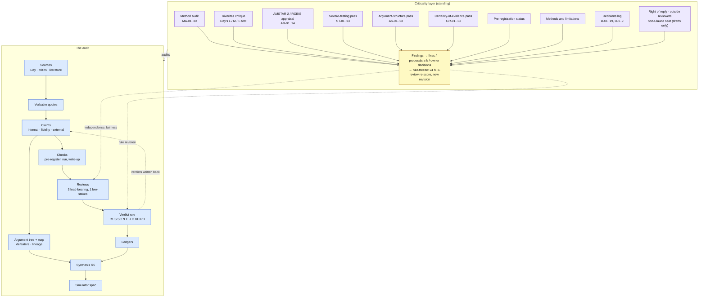

# Criticality layer: the audit auditing itself

*Created 2026-10-12 at the owner's request ("add all this as a 'criticality layer'"). Standing layer, not a one-off.*

**What it is.** The per-check reviews (`research/checks/REVIEW.md`) test the maths of one check. The criticality layer tests everything around the maths: the method, the logic of the verdict rules, the epistemology of what a verdict can claim, the independence of the reviewers, the fairness of the two-sided treatment, and the gap between what the documents say and what was done. It produces findings about the project, not about Day or his critics. Its output is tracked to closure like any other work item.

**Who runs it, stated plainly.** Every pass so far was run by a Claude instance inside the project's own session, under one owner. It is therefore not independent, whatever it is called (the first audit says so itself, MA-01 and its preface). A pass counts as outside review only if the dated audit file records a named reviewer who is not the project's model family or not the project's owner. None is recorded yet.

## Where it sits in the audit (compact diagram)

The full figure is [`docs/img/audit-systems.svg`](../../img/audit-systems.svg); the verdict logic is [`docs/img/audit-verdict-logic.svg`](../../img/audit-verdict-logic.svg); outstanding work is in [`../ROADMAP.md`](../ROADMAP.md).

## Components

| # | Component | File | Status (2026-10-12) |
|---|---|---|---|
| i | Third-party-style method audit, findings MA-01 to MA-20 | [`METHOD-AUDIT-2026-10-12.md`](METHOD-AUDIT-2026-10-12.md); proposals: [`METHOD-AUDIT-proposals.md`](METHOD-AUDIT-proposals.md) | Done; remediation partly applied (table below) |
| ii | Triveritas critique: the audit assessed with Vox Day's own "Triveritas" system | [`triveritas-method.md`](triveritas-method.md) (what it is, versions, assessment), [`triveritas-audit-2026-10-12.md`](triveritas-audit-2026-10-12.md) (application; findings TV-01 to TV-11) | Done 2026-10-12; no verdict, rule or claim changed; same-model, not blind (TV-11) |
| iii | AMSTAR 2 and ROBIS appraisal: the audit judged as a systematic review by two published instruments (Shea et al. 2017; Whiting et al. 2016) | [`amstar2-robis-2026-10-12.md`](amstar2-robis-2026-10-12.md) (instruments fetched and quoted item by item; mapping; ratings with evidence; PRISMA-style flow of sources; the same questions put to Day's case and two critic rebuttals; findings AR-01 to AR-14) | Done 2026-10-12; no verdict, rule or claim changed; one rater, same-model, not blind (AR-13) |
| iv | Severe-testing pass: every run check graded for whether it could have shown the inference drawn from it to be wrong (Mayo's severity requirement; SEVERE, PARTIAL, WEAK, BENT) | [`severe-testing-2026-10-12.md`](severe-testing-2026-10-12.md) (framework fetched and quoted; rubric committed before scoring; 57 checks graded; cross-tabulation against the pre-registration label; verdicts resting on weak probes; the same question put to Day's and the critics' own tests and to the four queued checks; findings ST-01 to ST-13) | Done 2026-10-12; no verdict, rule or claim changed; one rater, same-model, not blind, rubric written after the checks were read (ST-13) |
| v | Argument-structure pass: every load-bearing node laid out for three parties (Day, the critics, the audit's own verdict) by Toulmin's model (claim, grounds, warrant, backing, qualifier, rebuttal) and Walton's argumentation schemes with their critical questions; the exchange scored against the ten pragma-dialectical rules | [`argument-structure-2026-10-12.md`](argument-structure-2026-10-12.md) (frameworks fetched and quoted, 95 quotes; rubric committed before any node was laid out; 15 nodes in full and 18 in a compact table, 83 layouts; fallacy audit and ten-rule table for all three parties; aggregates; proposals; findings AS-01 to AS-13) | Done 2026-10-12; no verdict, rule or claim changed; one rater, same-model, not blind; three of the schemes are the pass's own construction and the frameworks' primary books were not obtained (AS-13) |
| vi | Certainty-of-evidence pass: every decided external verdict on a load-bearing node, and a seeded sample of 30 others, rated by an adapted GRADE (high, moderate, low, very low; five reasons to rate down, three to rate up), with a direction for each and the same rules put to the parties' headline numbers | [`grade-certainty-2026-10-12.md`](grade-certainty-2026-10-12.md) (GRADE texts fetched and quoted, 67 quotes; adaptation committed before any rating; 58 rows with a recomputable code line; three starting-level mappings; aggregates; comparison with the four-way split, the Triveritas pass and the severity grades; proposal k; findings GR-01 to GR-13) | Done 2026-10-12; no verdict, rule or claim changed; one rater, same-model, not blind; four rules settled while rating; the GRADE Book and the single-domain papers not obtained (GR-07, GR-13) |
| vii | Method audit of the 2026-10-13 batch (HF post hoc run `ph`, L1b, L1c, FMnull, L5): pre-registration order against host records, symmetry of the lead's rulings, reachability of each side's outcomes, verdict moves withheld and applied, independence of review, the audit's own errors and whom each favoured | [`METHOD-AUDIT-2026-10-13.md`](METHOD-AUDIT-2026-10-13.md) (ten runs timed against pushes; 24 steelman conflicts tabulated; nine claim-file edits sampled; Q272 to Q274 checked against the held texts; record beside ST-10; proposals l and m; findings MA-21 to MA-30) | Done 2026-10-13; no verdict, rule or claim changed; fresh same-model instance, not blind (briefed by the lead with its own list of weak points), not the integrator |
| viii | Pre-registration status of every registered check | [`research/checks/PREREG-STATUS.md`](../../../research/checks/PREREG-STATUS.md) (generated by `research/tools/prereg_status.py`) | Done; 61 rows: blind 10, criterion-only 6, reproduction 3, single-commit 18, unknown 20, registered-not-run 4 in the committed file. Regenerated to scratch by pass vii on 2026-10-13 and not committed (outside that pass's write scope): blind 14, registered-not-run 0; L1b, L1c, FMnull and L5 all land in `blind`, HF `ph` has no row (MA-25) |
| ix | Methods and limitations (publishable page) | [`METHODS-AND-LIMITATIONS.md`](METHODS-AND-LIMITATIONS.md) | Written; not yet linked from the repo front page beyond the READMEs; interests paragraph waits on O-9 |
| x | Owner decisions log and open decisions | [`../DECISIONS.md`](../DECISIONS.md) | Started; D-01 to D-19, O-1 to O-9, O-24 to O-27 (O-10 to O-23 are proposed in `ROADMAP.md` section C and not yet recorded there) |
| xi | Outreach: right of reply, outside human reviewers, non-Claude review seat, COI and licence | [`../outreach/`](../outreach/) | Drafts only. Nothing sent; nobody approached (hard rule 6) |
| xii | Hostile reviews (one from a sharp reader on Day's side, one from a sharp evolutionary biologist who thinks the audit grants Day too much) | Section "Hostile reviews" of [`METHOD-AUDIT-2026-10-12.md`](METHOD-AUDIT-2026-10-12.md) | Done, written by the same model; both answered in the "unfair criticisms" section there |
| xiii | Quote-miss diagnosis (EVO-78): the four standing `argmap_check.py` verbatim-quote errors traced to their origin commit and classified | [`QUOTE-MISSES-2026-10-14.md`](QUOTE-MISSES-2026-10-14.md) (findings QM-01 to QM-04; matcher and corpus read; longest-prefix divergence located for each; `git log -S` dating) | Diagnosed 2026-10-14; **nothing applied** — `lineage.yaml` and `defeaters.yaml` untouched. All three strings date to `9a2148b` (the original argmap build), so classification (c) is ruled out and L2/EVO-41 is cleared. QM-01 (a); QM-02 (b); QM-03/QM-04 (b, verbatim-vs-paraphrase undecidable without re-fetching the Dembski interview). Awaiting owner ruling; the retraction branch of QM-03/QM-04 would move an `A5`/P2 defeater |

*Rows vii to xi were numbered iii to vii until the AMSTAR 2 and ROBIS pass was added as iii, iv to viii until the severe-testing pass was added as iv, v to ix until the argument-structure pass was added as v, and vi to x until the certainty-of-evidence pass was added as vi, all later on 2026-10-12. On 2026-10-13 the method audit of that day's batch was added as vii and rows vii to xi became viii to xii. No file referred to them by number.*

## Findings of the 2026-10-12 method audit and their status

Status key: **remediated** = the fix that changes no rule, vocabulary or verdict is done; **proposal** = specified in `METHOD-AUDIT-proposals.md`, not applied; **needs owner** = only the owner can act (see `DECISIONS.md`); **open** = no action yet. Where a finding has parts in several states, the status shown is that of the part that still blocks closure, and the note gives the rest. Evidence: commits since `640aafa`, `DECISIONS.md`, the proposals file.

| ID | Severity | Finding | Status | Note |
|---|---|---|---|---|
| MA-01 | CRITICAL | Three reviews are three prompts to one reviewer | needs owner | HANDOFF tier statement corrected (`255c9b8`). Seeded-error test and blind re-derivation specified (proposal f), not run. Non-Claude seat and human geneticist: O-3, O-4, packets drafted |
| MA-02 | MAJOR | RH6 rewards distance from the truth | proposal | Proposal d |
| MA-03 | MAJOR | Rules remade on the day they decided verdicts | needs owner | `DECISIONS.md` started (`22488c0`). Revert of B internal and A2e external to pre-10-11 values or re-review: O-5, owner asked for an explanation. Stale "most charitable to Day" comments in C7 and B9 still present |
| MA-04 | MAJOR | Pre-registration unverifiable or empty for many checks | remediated | Descriptive labels (`a15b294`). Forward rule (pushed timestamps, partitioning bands) not adopted |
| MA-05 | MAJOR | "External" often decided by the disputed theory | proposal | Proposal b: 52 decided external verdicts coded 16 data, 10 literature, 26 model; no load-bearing external verdict rests on data the audit processed |
| MA-06 | MAJOR | Day-versus-critics error rate does not measure what it appears to | remediated | Rates and Fisher p-values removed from public pages (O-8, `8b6f95b`) |
| MA-07 | MAJOR | `holds` is the default | proposal | Proposal a: 6, 24, 36 or 58 internal `holds` become `unexamined`, by definition chosen |
| MA-08 | MAJOR | `contested` holds five different things | proposal | Proposal c: all 114 `contested` re-coded |
| MA-09 | MAJOR | The audited book has not been read | needs owner | O-1: owner will purchase; no PDF listing found; no DRM bypass |
| MA-10 | MAJOR | No one outside the loop has been asked anything | needs owner | O-2, O-3: drafts in `outreach/`; send needs approval of exact text and channel |
| MA-11 | MAJOR | No aggregation rule and no stopping rule | proposal | Proposal e; O-7 corpus freeze accepted by owner ("fine"), interpretation to be confirmed |
| MA-12 | MINOR to MAJOR | Verdicts ran ahead of the like-for-like test | closed | DN1-DN3 comments marked conditional on L1b (`f3a1790`). L1b reported 2026-10-13 (band CRITIC) and the condition was discharged with the registered sentence (`cf03b3b`). Checked and closed by pass vii (`METHOD-AUDIT-2026-10-13.md`, concordance). Residue, not blocking: L1b ran GENCODE v35, Day names v46; a superseded sentence left in DN1's comment (MA-28) |
| MA-13 | MINOR | One decomposition from the first summary pass | open | Mirror tree not built |
| MA-14 | MINOR | The 25% line was set in the gap of observed slips | open | No action |
| MA-15 | MINOR | Category leaks in the three-verdict scheme | open | `side: audit` not specified; `A4` internal outside vocabulary passes lint |
| MA-16 | MINOR | From "the simulation shows" to hominids | open | Disclosed; no change |
| MA-17 | MINOR | Presentation manufactures symmetry | open | Partly touched by the MA-06 removals |
| MA-18 | MINOR | Budget decides depth | open | Mechanical tier test not specified |
| MA-19 | MINOR each, together MAJOR | What is missing | needs owner | Methods and limitations page written (`e17e5c0`). LICENSE and COI: O-9, drafts only. One-command quote verification not built |
| MA-20 | COSMETIC | Documents disagree with practice | open | HANDOFF and AGENTS items fixed (`255c9b8`); residual items (stale comments, README status table, totals off by one) not re-checked |

**Counts by status (20 findings):** closed 1 (MA-12, by pass vii on 2026-10-13); remediated 2 (MA-04, MA-06); proposal 5 (MA-02, MA-05, MA-07, MA-08, MA-11); needs owner 5 (MA-01, MA-03, MA-09, MA-10, MA-19); open 7 (MA-13 to MA-18, MA-20). **By severity:** CRITICAL 1, MAJOR 10, MINOR to MAJOR 1, MINOR 7 (MA-13 to MA-19, MA-19 also "together MAJOR"), COSMETIC 1. One finding (MA-12) is closed in the sense of "re-audited and confirmed fixed", by a same-model pass.

## Findings of the 2026-10-13 method audit (pass vii: the batch of 2026-10-13)

*Added 2026-10-13. File: [`METHOD-AUDIT-2026-10-13.md`](METHOD-AUDIT-2026-10-13.md). Scope: commits `d0d8493..cb5ed16` (HF post hoc run `ph`, L1b, L1c, FMnull, L5: runs, write-ups, reviews, fix passes, integration). Reviewer: a fresh same-model instance, not blind, not the integrator. No verdict, rule or claim changed.*

**Sound:** every script and the pre-run note were pushed before the launch they govern (four checks; md5 in each host record equals the git blob, 10 of 10); post hoc scripts are labelled and were pushed before their runs; reviews found the lead's own errors in both directions; no verdict moved on a weak test (L5's registered flip against Day was withheld); the audit's errors are in the claim files; rulings on 24 steelman conflicts went 5 to Day's reviewer, 5 to the critics', 14 split; Q272 to Q274 verbatim. **Pre-registration class by the tool:** L1b, L1c, FMnull, L5 `blind`; HF `ph` no row.

| ID | Severity | Finding (short) | Status | Who | Concordance |
|---|---|---|---|---|---|
| MA-21 | MAJOR | One instance is author, briefer and judge: the lead wrote the `ph` scoring, the pre-run notes, the launch fixes and every ruling between steelman reviews, and briefed each reviewer with its suspicions; briefs not in git; rulings reached claim files 4 to 8 minutes after each fix pass, unreviewed | needs owner | owner (O-26), agent for the briefs | repeats MA-01, TV-01, AR-13, ST-13, AS-13, GR-13; new evidence |
| MA-22 | MAJOR | "Extended reading" and "registered wording governs" are applied case by case; four verdict fields (DN1 external, DN6 external and fidelity, C external) rest on calls the rule text does not reproduce. Direction mixed | proposal | agent, then owner | repeats MA-03, AS-04 in a new form. Proposal m |
| MA-23 | MAJOR | L5 had one combined review while carrying a registered verdict flip; the lead's pre-run note said "three reviews"; the one review found 7 MAJOR | needs owner | owner (O-25) | new |
| MA-24 | MAJOR | Day-side outcomes were unreachable in parts of three of four new checks (L5 DAY band at s <= 0.01; FMnull S2, S3, S4; L1c "x <= 3"), one in Day's favour (L1c Reading A cannot be `contradicted`); L1b fixed before launch | proposal | agent | repeats ST-05; four new instances. Proposal l for FMnull; B36 |
| MA-25 | MINOR | The `blind` label overstates L1c, FMnull and L5 (pre-run amendments, selftests seen); `ph` has no row and its push is not shown to precede its launch; committed `PREREG-STATUS.md` stale | open | agent (integrator) | repeats MA-04; agrees with ST-01 |
| MA-26 | MINOR | One agent wrote both L1c steelman reviews, on the check that moved DN6 in two fields | needs owner | owner (O-26) | new |
| MA-27 | MINOR | The lead fixed a reading of the L5 selftest miss before the run and its direction was wrong; reversed by review | open | agent | new |
| MA-28 | MINOR | Two drifts from write-up to claim file: C widens the registered scope "s <= 1e-2" to 0.02; DN1 keeps a superseded sentence | open | agent (integrator) | new |
| MA-29 | MINOR | Side tallies (Day 6 of 24, critics 24 of 25 over the batch) are of predictions the audit wrote; three write-ups and DN1 print counts by side without saying so | open | agent | repeats MA-06 |
| MA-30 | COSMETIC | Process and documents out of step: three subagents against the cap of two (D-11) with no recorded decision; a waiter on the compute host with no script in git; README says three reviews for every check | needs owner | owner (O-24) | repeats MA-20 |

**Counts (10 findings).** By severity: MAJOR 4, MINOR 5, COSMETIC 1. By status: needs owner 4 (MA-21, MA-23, MA-26, MA-30), proposal 2 (MA-22, MA-24), open 4 (MA-25, MA-27, MA-28, MA-29). None is closed.

**Concordance** (over the 10 findings): repeats an earlier finding with new evidence 6 (MA-21, MA-22, MA-24, MA-25, MA-29, MA-30); new 4 (MA-23, MA-26, MA-27, MA-28). **Closed by this pass:** MA-12, ST-08, ST-09. **Remediated, not closed:** ST-10. **Disagreement in part:** with ST-07's reading that the failure record never helps Day (a registered move against him was withheld on the audit's own severity note), and it confirms ST-01 against MA-04's remedy (pushed registration raised the `blind` count by four and made no unreachable band reachable). **Held back:** proposal l (a fairer Day-side criterion for FM10; could move FM10 and ROOT-FM external, both load-bearing) and proposal m (an operational test for "extended reading"), both under the rule-freeze procedure. **New open owner decisions:** O-24 to O-27.

## The Triveritas critique: what it is and what it found

**What it is.** Day's own critique system, published with the listed co-author "Claude Athos" in February and March 2026: "The Triveritas holds that a claim merits warranted assent if and only if it satisfies three jointly necessary conditions: logical validity (L), mathematical coherence (M), and empirical anchoring (E)." (Q203, [`quotes-day.md`](../sources/quotes-day.md)). He uses it to pass or fail theories, papers and other people's arguments, first as three pass/fail tests and later as 0 to 100 scores. Each leg exists in three versions in his texts, with three different pass marks (50, 60, 90).

**How it is applied here.** As a lens, not a re-score: each leg is applied to the audit's method under every version Day gave (readings a, b, c), to seven sample verdicts (B, A2e, C7, DN6, B5c, G2e, H8) with the Day and critic claim beside each, and to the two top-level positions (Day's root claim and the critics' positive thesis). Day's own protocol says the authors do not score their own work (Q224); this pass is by the same model family as the audited work, was not blind, and breaks that rule (TV-11). It covers logic, mathematics and empirical anchoring only; fidelity to sources, fairness to named people, conflicts of interest and presentation are outside it.

**Headline result.** By Day's rule a failure on any leg withholds assent, and the audit's tallies and self-descriptions do not yet merit it: the weakest leg is E in the sense of independence ("observations the claimant does not control", Q212), the same place MA-01 sits. L-b fails (the verdict rule is a growing set of case-driven clauses, TV-02); M-c fails (thresholds are free parameters and no function leads from node verdicts to a conclusion, TV-05). Same readings, same test: Day's root claim and the critics' positive thesis also fail the conjunction as things stand, each most clearly on E. Credited as sound: quote handling machine-checked against hashed text, the checks that processed public data, the pre-registered long runs that report misses, and leaving a verdict `pending` until a like-for-like test exists.

| ID | Severity | Finding (short) | Concordance with MA |
|---|---|---|---|
| TV-01 | CRITICAL | By Day's corollary the audit is self-sealing in practice (every confirming act is by the party whose claim it confirms) | agrees with MA-01 |
| TV-02 | MAJOR | The verdict rule is a set of accommodations with no overfitting test | new as a whole; MA-02, MA-03, MA-14 found parts |
| TV-03 | MAJOR | The audit has made no prediction about itself that could fail | new |
| TV-04 | MAJOR | Load-bearing external verdicts are mathematics without anchoring, the fault Day charges to a critic | agrees with MA-05, MA-16 |
| TV-05 | MAJOR | Thresholds are free parameters; the multiplicative band is undefined where used | agrees with MA-02, MA-14 |
| TV-06 | MAJOR | Three columns allow the trade-off the Triveritas forbids | partly disagrees with the method audit's defence of column-wise reporting |
| TV-07 | MINOR to MAJOR | Claims without mathematics pass by default | new remedy for MA-06, MA-07 |
| TV-08 | MAJOR | No rhetoric exemption in the Triveritas; RH6 and the Triveritas conflict | agrees with MA-02 |
| TV-09 | MINOR | Day's Triveritas claims about evolution are in the corpus and unaudited | new |
| TV-10 | MINOR | Verdicts carry no as-of date | new |
| TV-11 | CRITICAL for the standing of the document | This application is itself outside Day's protocol (same family, not blind) | independence, as MA-01 |

**Concordance counts** (the Triveritas pass's own tally of the 20 MA findings; some appear in two groups): agrees 11, agrees in part 3, partly disagrees 3 (MA-05 remedy 2, MA-08, and the column-wise defence under MA-07), not covered or only touched 6 (MA-06 beyond the statistic, MA-17, MA-18, part of MA-19, the fairness half of MA-10, the mechanics of MA-04). What the method audit found that the Triveritas cannot see: fidelity, fairness to named people, conflicts of interest, presentation, budget. No TV finding is closed. Remediation (no-decision fixes, proposals, proposed owner decisions O-10 to O-12, which are not yet in `DECISIONS.md`) is in section 7 of the audit file and rows B18 to B20 and C14 to C16 of [`../ROADMAP.md`](../ROADMAP.md).

## The AMSTAR 2 and ROBIS appraisal: what it is and what it found

**What it is.** Two published instruments for appraising systematic reviews, applied to this audit as if it were one. AMSTAR 2 has 16 items, seven of them critical, and an overall confidence rating; ROBIS has four domains of signalling questions and an overall risk of bias. Both were built for reviews of healthcare interventions (AM-00, RB-00 in [`quotes-literature.md`](../sources/quotes-literature.md)), so most items apply by analogy: "included studies" are sources and claims, "risk of bias in included studies" is the appraisal of each claim, "meta-analysis" is the verdict tallies and the planned R5 synthesis. Where an analogy can be read two ways, both readings are rated. The applier is one instance of the same model family as the audited work, not blind and not independent (AR-13).

**Headline result.**

| Instrument | Rating | Reasoning |
|---|---|---|
| AMSTAR 2, tallies read as a synthesis | **Critically low** | Three critical domains fail: item 2 (plan not registered before the work, written after a first pass, departures unlogged), item 11 (synthesis by vote count with no registered rule), item 15 (check selection and unread sources not analysed) |
| AMSTAR 2, literal reading (no statistical meta-analysis) | **Low** | One critical flaw: item 2. No reading gives high |
| AMSTAR 2, critical domains not failed | | Item 4 search (partial yes), item 7 excluded list (partial yes), item 9 appraisal technique (partial yes), item 13 limits considered (yes) |
| ROBIS, overall | **High risk of bias** | High concern in all four domains: eligibility, identification and selection, data collection and appraisal, synthesis and findings. Unclear on the most lenient reading of phase 3; never low |

**Credited as sound:** excluded sources listed one by one with reasons (99 blog posts, 72 pre-2019 posts, 11 Zenodo records); a documented search for Day's corpus that added 81 candidates to the tag's 172; detailed description of every source; a formal appraisal applied to all sides; limits stated beside the results.

**PRISMA-style flow, first draft** (section 6 of the pass). Day's blog: 244 on the tag and 81 more by search; 253 fetched and screened; 154 kept; 99 excluded with reasons; 72 pre-2019 listed, not fetched. Zenodo: 39 records; 28 downloaded; 11 set aside on titles, of which 10 were found in scope five days later. Bibliography rows: 299 Day, 66 critics and allies, 132 literature. Claim files: 233. Not countable: critics identified and screened, literature identified, and how many sources reached a claim.

**The same questions put to the audited parties.** By the letter Day's case and the critic rebuttals also rate critically low and high risk; that says only that a book and a blog series are not systematic reviews, and no rating is assigned to them. On the questions that transfer, each party has something another lacks (pass, section 8).

**What would raise the ratings.** Existing proposals plus the agent-side AR remedies: AMSTAR 2 to low, or moderate if a registered forward protocol with a deviations log is accepted as partial yes on item 2. Owner-dependent items (the book, an outside second screener and reviewer, the right of reply, the interests statement): moderate, and ROBIS low concern becomes possible. Moderate is the realistic ceiling, because item 2 cannot be met for work already done.

| ID | Severity | Finding (short) | Status | Who | Concordance with MA and TV |
|---|---|---|---|---|---|
| AR-01 | MAJOR | The plan was not registered or publicly timestamped before the work and was written after a first pass | needs owner | agent, then owner | new at review level; MA-03, MA-04, TV-02 found the pattern in rules and checks. Amendment text: agent; outside timestamp: proposed O-13 |
| AR-02 | MAJOR | No log of departures from the plan | open | agent | new; MA-03, MA-20 found parts |
| AR-03 | MAJOR | Selection by one screener per slice; ten of eleven title-based Zenodo exclusions later reversed | open | agent, outside | new |
| AR-04 | MAJOR | Extraction single-pass, completeness unchecked, no field linking a claim to its bib source | open | agent | agrees with MA-09; completeness and link are new |
| AR-05 | MAJOR | Search uneven across arms; some critics found only through Day's own posts; literature arm has no strategy | open | agent | agrees in part with MA-09, MA-10; the route is new |
| AR-06 | MINOR | The search cannot be re-run from one place; no per-query hit counts for the critics' arm | open | agent | new |
| AR-07 | MINOR | No single excluded-sources list; one-word reasons; full-text, title, date and keyword-scan exclusions mixed | open | agent | new |
| AR-08 | MINOR | No flow of sources existed; three boxes cannot be counted | open | agent | new. First draft is in the pass; not yet generated by script |
| AR-09 | MINOR | Eligibility written as a criterion for Day's corpus only; language unstated; source types unexplained | open | agent | new |
| AR-10 | MINOR | Interests of the audited authors not recorded, on any side | open | agent | new; MA-19 covers the audit's own interests |
| AR-11 | MAJOR | No written rule for which claims get a check; coverage differs by side and its effect is not analysed | open | agent | agrees in part with MA-06, MA-07, MA-13 |
| AR-12 | MAJOR | The draft synthesis rule (proposal e) has statements for Day's branches only and no confidence grading | open | agent, owner | agrees with MA-11, MA-13; the asymmetry is new. To be specified as an extension of proposal (e) |
| AR-13 | CRITICAL for the standing of the document | This appraisal is one rater, same model family, not blind; a same-family second agent would satisfy "two reviewers" on paper | needs owner | owner, outside | independence, as MA-01 and TV-11 |
| AR-14 | COSMETIC | Three statements disagree with the methods page (README l.256 "checked blind"; stale review text in `PLAN.md`; lagging `status` fields) | open | agent | new instances under MA-20 |

**Counts (14 findings).** By severity: CRITICAL for the document's standing 1, MAJOR 7, MINOR 5, COSMETIC 1. By status: needs owner 2 (AR-01, AR-13), open 12. None is closed.

**Concordance** (21 rows: 16 AMSTAR 2 items, four ROBIS domains, ROBIS overall): agrees with an MA or TV finding 9, agrees in part 5, partly disagrees 2, new 5. The two partial disagreements run in the audit's favour and should be read with that in mind: AMSTAR 2 gives partial credit for a formal appraisal technique without asking who applied it (against MA-01 and TV-01), and credits limits stated beside the numbers (against MA-17 and TV-06). What these instruments see that the earlier passes did not: search, selection, the excluded list, the flow of sources, the interests of the audited authors, registration of the plan, a deviations log. What they cannot see: the logic of rule RH6, external verdicts decided by the disputed theory, the mirror tree, budget, fairness to named people. No MA or TV finding is closed or contradicted by this pass. Remediation is in section 11 of the pass and rows B23 to B33 and C17 to C19 of [`../ROADMAP.md`](../ROADMAP.md); the proposed owner decisions O-13 to O-15 are not yet in `DECISIONS.md`.

## The severe-testing pass: what it is and what it found

**What it is.** Deborah Mayo's error-statistical requirement, applied check by check: "A statistical hypothesis H passes a severe test T with data x0 if, (S-1) x0 agrees with H, and (S-2) with very high probability, test T would have produced a result that accords less well with H than x0 does, if H were false." (SV-MS1, [`quotes-literature.md`](../sources/quotes-literature.md)); where a method "had little or no capability of finding flaws" the result is "bad evidence, no test (BENT)" (SV-B1b). Pre-registration asks whether the criterion was fixed first. Severity asks whether the fixed criterion could have failed. The framework was taken from two author-posted papers, one arXiv paper, one open-access paper and two posts on the author's blog; **the 2018 book was not obtained**, and remarks on Popper and on Bayesian confirmation beyond the quoted passages are from memory and marked so.

**How it is applied here.** A rubric written into the file and committed (`63227e3`) before any grade: the inference each check drew is named and typed (derivation or tool, world, reading or tag); six questions are coded (was a discordant outcome named, was it reachable, is the instrument calibrated on known cases, was the criterion independent of the outcome, are the bands exhaustive, is the recorded inference within the scope probed); a fixed rule turns the codes into SEVERE, PARTIAL, WEAK or BENT. All 57 run checks were graded from their registration-commit docstrings, their paragraph in `RESULTS.md` and the scoring rows of their write-ups; none was sampled. The grades are one same-model rater's judgement and the rubric was written after the checks had been read (ST-13).

**Headline result.**

| | SEVERE | PARTIAL | WEAK | BENT | Total |
|---|---|---|---|---|---|
| All run checks | 13 | 29 | 7 | 8 | 57 |
| Checks targeting a load-bearing node | 7 | 22 | 4 | 4 | 37 |
| Label `blind` | 2 | 7 | 0 | 1 | 10 |
| Label `criterion-only` | 0 | 1 | 3 | 2 | 6 |
| Label `reproduction` | 1 | 2 | 0 | 0 | 3 |
| Label `single-commit` | 4 | 11 | 2 | 1 | 18 |
| Label `unknown` | 6 | 8 | 2 | 4 | 20 |

- **Registration and severity are close to unrelated.** 2 of the 10 `blind` checks are SEVERE and one (G2c / B6c) is BENT; 11 of the 13 SEVERE checks are not `blind`.
- **All 13 SEVERE checks are recounts or derivations set against an independent calculation (7) or readings of public data (6).** None of the 15 checks that address the world by simulation or model alone is SEVERE.
- **Predictions fail and are reported:** at least 98 failed or missed audit predictions in 31 of 57 checks. Every `blind` check has one; 4 of the 18 `single-commit` checks do; the BENT checks could not.
- **Thirteen decided verdict fields rest only on WEAK or BENT probes** (a lower bound). Four are live and load-bearing: B internal `non-sequitur`, A2e external `contradicted`, F1a internal `non-sequitur` (against Day) and B6 external `supported` (for a critic). A design for a severe probe of each is in section 6 of the pass.
- **Where the weakness points:** of 44 checks below SEVERE, the critics' side in 22, Day's in 1, both in 1, neither in 20.
- **The same question put to the parties:** Day's MITTENS calculation and mesa statistic could not have come out against him; his aDNA zero is no test against neutral theory and its power against selection is what the queued L5 computes; his dN/dS result is weakly probed as presented. Most critic replies are derivations from the standard model and no test of it; keruru's temporal N_e is the exception and was reproduced.
- **Queued checks:** L1b in design severe for the data statement, with two unclassified band regions (ST-08); L5 a sound power analysis whose own predictions contradict its band rule (ST-09); L1c near severe after its amendment (planted effects, negative controls), short of it because the protein-guided arms are the audit's stand-ins; FMnull severe for a Day-side result and weak for a critic-side one (ST-10).

**Credited as sound:** the recounts and data checks; open reporting of misses; three cases where a weak probe was followed by a stronger one unprompted (C1 to C1d, H2-hard to H8, L7's base-rate control); Day's recountable numbers reproducing (L6, B3m, B2/B).

| ID | Severity | Finding (short) | Status | Who | Concordance with MA, TV and AR |
|---|---|---|---|---|---|
| ST-01 | MAJOR | Registration status does not track severity; "count 10 checks as pre-registered tests" is not a count of tests | open | agent | agrees in part with MA-04; disagrees with its remedy's emphasis and with the methods-page sentence |
| ST-02 | MAJOR | No simulation-only check is severe for a claim about the world; 13 verdict fields rest only on WEAK or BENT probes | proposal | agent, then owner | agrees with MA-05, TV-04; the list of fields is new |
| ST-03 | MAJOR | Four live load-bearing verdicts (B internal, A2e external, F1a internal, B6 external) rest for their deciding step on WEAK or BENT probes, and all four lean to the critics' side | needs owner | owner (proposed O-17), agent for the probes | agrees with MA-03 on B and A2e; F1a and B6 are new |
| ST-04 | MAJOR | The untested risk points one way (22 to 1), and critic-only checks are the weakest probes (0 SEVERE of 6) | open | agent | agrees in part with MA-05, MA-06, AR-11; the count is new |
| ST-05 | MAJOR | Eight checks registered a falsifier that could not fire or predictions that could not fail; three are reported as "All predictions met" | proposal | agent | new (MA-04 found non-exhaustive bands, a different defect) |
| ST-06 | MAJOR | The one independent-engine probe (XT) returned discordant counts that were set aside unlocalised; follow-up not run | open | agent | new. Methods-page sentence corrected in this pass |
| ST-07 | MINOR | The failure record is real and uneven (blind 10 of 10 checks with a miss; single-commit 4 of 18); no miss has yet changed a load-bearing verdict value in Day's favour | open | agent | agrees in part with MA-04; adjacent to TV-03 |
| ST-08 | MINOR | L1b's registered bands leave two outcome regions unclassified, one of them Day-favourable | closed | agent, before launch | agrees with MA-04; new instance. Both regions assigned in a pre-run note pushed 56 s before launch (`5e64f0a`); neither reached. Checked and closed by pass vii |
| ST-09 | MINOR | L5's registered predictions contradict its band rule; half of its DAY band is unreachable by its own arithmetic | closed | agent, before launch | new. Answered in the pre-run note before launch (`5e64f0a`, items 1 to 5); the registered flip was then withheld. Checked and closed by pass vii; the unreachable half is carried as MA-24 |
| ST-10 | MINOR | FMnull is a severe test of a Day-side outcome and a weak test of a critic-side one | remediated | agent, at write-up | new. Severity limit leads `R4-FMnull.md`; widths, sourced shares and power both ways given; tree-incongruence not measured; see the note under this table |
| ST-11 | MINOR | Reconstructions of unstated methods lack a base-rate control (B3 family), except L7 | open | agent | new |
| ST-12 | MINOR | The audit's strongest objections to Day are severity objections and the vocabulary has no place for them; neither party's own tests are graded in the claim files | proposal | agent | new; touches MA-08, MA-15 |
| ST-13 | CRITICAL for the standing of the document | One rater, same model family, not blind; rubric written after the checks were read; several grades one code from the next | needs owner | owner, outside | independence, as MA-01, TV-11, AR-13 |

**Counts (13 findings).** By severity: CRITICAL for the document's standing 1, MAJOR 6, MINOR 6. By status: needs owner 2 (ST-03, ST-13), proposal 3 (ST-02, ST-05, ST-12), remediated 1 (ST-10), closed 2 (ST-08, ST-09; by pass vii, 2026-10-13, same-model), open 5.

**Record beside ST-10 (added 2026-10-13 by pass vii from the FMnull reviews; no decision, no rule change).** (1) FMnull's undecided margin (N_hi / 3 to 3 N_hi) is symmetric about the stacked upper corner, where every component is at its upper end at once: a value at the null's own centre scores CRITIC, and under SOURCED the central neutral simulation is itself MARGINAL-IN at 100 kb. (2) The margin is taken on the value and not on the excess: for the lineage-split index, whose Poisson floor is 1, 3x on the value asks for an excess 9.2 times the bound's at 10 kb. (3) Criterion S2 was unreachable: no planted model, including one of the size Q169 (b) asserts (audit gloss), meets it off the window grid. This is a defect of the audit's criteria, on Day's side; "S2 unmet" is not counted against him. (4) The "not discriminating" ratio (band width above 9) was set in the fix pass, after the results; it is a reporting convention of that write-up. A fairer Day-side criterion is specified as proposal l in [`METHOD-AUDIT-2026-10-13.md`](METHOD-AUDIT-2026-10-13.md) section 7b and is held back under the rule-freeze procedure.

**Concordance** (over the 13 ST findings): agrees with an MA, TV or AR finding 3 (ST-02, ST-03, ST-13); agrees in part 4 (ST-01, ST-04, ST-07, ST-08); new 6 (ST-05, ST-06, ST-09, ST-10, ST-11, ST-12). One partial disagreement, with MA-04's remedy and the methods page: pushed timestamps would raise the `blind` count without making any check more able to fail, and the "10 tests" include one that could not fail and leave out eleven that could. Two refinements of earlier findings: an internal `holds` that rests on a recount is among the best-probed verdicts (against reading MA-07 as "holds means unexamined"), and reviews produced the discordant result in at least seven checks (against reading MA-01 as "reviews catch nothing"; the catch rate is still unmeasured). What severity sees that the earlier lenses did not: whether a registered falsifier could fire, what was done with a discordant result, which way the untested risk points. What it cannot see: sources not read, selection of claims, fairness to named people, the rule history, any claim that never had a check. No MA, TV or AR finding is closed or contradicted by this pass. Remediation is in section 11 of the pass and rows A19 to A22, B34 to B40 and C20 to C21 of [`../ROADMAP.md`](../ROADMAP.md); the proposed owner decisions O-16 and O-17 are not yet in `DECISIONS.md`; the proposed `severity` field (section 10 of the pass) is a proposal only.

## The argument-structure pass: what it is and what it found

**What it is.** Three lenses from argumentation theory, applied to the 33 load-bearing nodes and to three parties on each: Day's side, the critics' side, and the audit's own verdict taken as one more argument. Toulmin's layout asks for the claim, the grounds, the warrant ("A statement authorizing movement from the ground to the claim.", AT-07, [`quotes-literature.md`](../sources/quotes-literature.md)), its backing, the qualifier (how strongly the claim is worded) and the rebuttal (what would defeat it). Walton's argumentation schemes attach critical questions to each kind of argument; "If one of the questions cannot be answered clearly this is an indication that the argument is weak" (AT-19). The pragma-dialectical rules describe a fair critical discussion. The frameworks were taken from open texts: papers by Walton, by Macagno, Walton and Reed, and by van Eemeren and co-authors, three Stanford Encyclopedia entries, and, where nothing better was open, Wikipedia and two derived restatements, each marked as such. **Toulmin 1958, Walton, Reed and Macagno 2008 and van Eemeren and Grootendorst's books were not obtained.** Walton's list has no scheme for an inference from a model to the world, for a recomputation on an author's own basis or for fixing the reading of a text; the pass defines those three itself and says so.

**How it is applied here.** A rubric written into the file and committed (`44c6d31`) before any node was laid out: codes for whether a warrant is stated where the argument is made, elsewhere or nowhere; for a qualifier worded above its licence, in the word only or in full; for whether rebuttal conditions are recorded; and for each critical question (answered with evidence for or against, asserted, unanswered). 15 nodes are laid out in full and 18 in a compact table, 83 layouts in all; counts are produced by script from the code lines. The audit's argument at each node was taken from the claim file, not from the check write-ups. One same-model rater, not blind (AS-13).

**Headline result.**

| | Day side | Critics | The audit |
|---|---|---|---|
| Layouts | 27 | 16 | 40 |
| Hidden warrants (stated elsewhere + nowhere) | 18 (2 + 16) | 4 (0 + 4) | 11 (10 + 1) |
| Qualifier mismatches (word only + full) | 20 (8 + 12) | 1 (1 + 0) | 10 (8 + 2) |
| Unanswered critical questions / scored | 42 / 90 | 16 / 36 | 33 / 150 |
| Rebuttal conditions unrecorded | 9 | 12 | 4 |

These are not error rates and are not comparable across parties: Day authored 24 of the 33 nodes, a critic layout is often one sentence, and the audit has up to three fields per node.

- **Seven of the eight decided `supported` or `contradicted` external verdicts on load-bearing nodes are worded above what their grounds license** (A2e, B1c, B3, B3a `contradicted`; B3g, B6, B7 `supported`). The ground is a model result, an identity inside a class of models, a model-based published estimate or the author's own withdrawal; the word is the one used for a data result. The `contested` verdicts that rest on simulations (A, B4a, B5, F2, H, H8) are worded within their grounds.
- **29 of the 74 decided verdict fields on these nodes carry no argument at the field.**
- **The audit's five most load-bearing unstated licences:** own basis (all 27 internal verdicts; contestable at A2e, F1a, C2 and B); model to world (6 of the 8 fields above, and the conditions of nine `contested`); the author's concession used as evidence (B3g `supported`; co-carries B3, B3a, B1c, B6); literature as benchmark (A2e and B1c external; the conditions of A, F2, H2, B4a); default and burden (what all 20 `contested` fields leave standing; ROOT and ROOT-M).
- **Fallacy risks, by party.** The audit: `holds` by default and "none found" without a stated search (argument from ignorance); the standard model as ground truth, disclosed on the methods page and not at the nodes; two verdicts decided on readings of its own making (A2e external, B internal); one word for data results and model results. Day: a universal impossibility defended by assigning the computation to others; analogy, sign and generalisation worded as proof; several terms used in two senses. Critics: one-line appeals to the textbook; the serial reading of Day's formula, half right; dismissal of a term a paper they had not engaged defines.
- **The ten rules.** No critical discussion has taken place between the audit and anyone it audits, so the rules on freedom to doubt, burden of proof and closure are untested for it. By count it is a third arguer: 146 of the 437 attacks in its argument map are its own checks' (100 on Day's nodes, 33 on critics'), none rated `not_upheld` by it. Its strongest rule is careful interpretation of the other parties' words; its weakest is the ambiguity of three of its own verdict words. Day's best rule is closure on specific points (four withdrawals on these nodes); the critics' is validity on short identities.

**Credited as sound:** 30 of 40 audit layouts have no gap between word and grounds, 29 state their licence where the verdict is stated, 32 record what would defeat them; recomputation questions answered with evidence 31 times in 40; no inference from Day's unpublished method to a defect (FM10); an unretrieved source not treated as false (C2, F3a); one verdict moved in Day's favour to avoid scoring a step twice (F); H8's external comment as the pattern for the rest.

| ID | Severity | Finding (short) | Status | Who | Concordance with MA, TV, AR and ST |
|---|---|---|---|---|---|
| AS-01 | MAJOR | Seven of eight decided `supported` or `contradicted` external verdicts on load-bearing nodes are worded above their grounds; 10 of 40 audit layouts in all | open | agent; rule-freeze if a word changes | agrees with MA-05, MA-16, TV-04, ST-02, ST-03; the field list and wording fix are new. Disagrees in part with the breadth of MA-05's remedy |
| AS-02 | MAJOR | 29 of 74 decided fields carry no argument at the field; 11 of 40 layouts have their warrant only in a standing document or nowhere | proposal | agent | new; touches MA-07, AR-04 |
| AS-03 | MAJOR | An author's withdrawal or concession is used as a ground in five external comments | needs owner | agent, then owner (proposed O-19) | new |
| AS-04 | MAJOR | A2e external and B internal are decided on readings made by the audit and not shown to be the author's | needs owner | owner (O-2, O-5; proposed O-20), agent | agrees with MA-02, MA-03, TV-02, TV-08, ST-03; the mechanism at A2e is new |
| AS-05 | MAJOR | Internal `non-sequitur` at A2e and F1a depends on an input the audit supplied and names no clause at the field; C2 cites an earlier version | open | agent; owner if a value moves | agrees in part with ST-03 |
| AS-06 | MAJOR | The audit argues as well as rates: 146 of 437 defeaters are its checks' attacks, none `not_upheld`; on six nodes the case against Day is the audit's alone | proposal | agent | agrees with MA-15, MA-13, TV-01, AR-12, ST-04; the counts are new |
| AS-07 | MAJOR | No critical discussion has occurred; freedom, burden and closure are untested for the audit; failure of a defence is decided by the check's author | needs owner | owner (O-2), outside | agrees with MA-10, MA-01, TV-01, TV-03; the closure rule is new |
| AS-08 | MINOR | The audit's most often unanswered question is whether the model or estimate presupposes what the other party disputes (9 of 33) | proposal | agent | agrees with MA-05, TV-04, ST-02; the count is new |
| AS-09 | MINOR | Arguments from absence without a stated search ("no derivation", later found; "No critic ... addresses ROOT"; `holds` by default) | open | agent | agrees in part with MA-07, MA-09, AR-05, AR-06 |
| AS-10 | MINOR | Markers about persons ("LLM-assisted", "advocacy") in claim files with no rule on when a source's nature may bear on weight; no scored use found | proposal | agent | new; touches AR-10 |
| AS-11 | MINOR | `contested` where the audit's own data corroborate one side (A3 external); 20 of 28 decided external fields `contested`; paired credits | proposal | agent | agrees in part with MA-08, MA-17, TV-06, ST-04 |
| AS-12 | MINOR | No place in the vocabulary for a party's over-statement or unanswered question | proposal | agent | agrees in part with ST-12, MA-15, TV-07 |
| AS-13 | CRITICAL for the standing of the document | One rater, same model family, not blind; constructed schemes; primary books not obtained; write-ups not re-read | needs owner | owner, outside (proposed O-21) | independence, as MA-01, TV-11, AR-13, ST-13 |

**Counts (13 findings).** By severity: CRITICAL for the document's standing 1, MAJOR 7, MINOR 5. By status: needs owner 4 (AS-03, AS-04, AS-07, AS-13), proposal 6 (AS-02, AS-06, AS-08, AS-10, AS-11, AS-12), open 3 (AS-01, AS-05, AS-09). None is closed.

**Concordance** (over the 13 AS findings): agrees with an MA, TV, AR or ST finding 6 (AS-01, AS-04, AS-06, AS-07, AS-08, AS-13); agrees in part 4 (AS-05, AS-09, AS-11, AS-12); new 3 (AS-02, AS-03, AS-10). One partial disagreement, with the breadth of MA-05's remedy: the simulation-based `contested` verdicts are worded within their grounds, so the re-coding can start with seven fields. Two refinements of earlier findings: internal verdicts on these nodes are mostly defended recomputations (against reading MA-07 as "holds means unexamined", as ST also found), and the over-claim is in the word chosen at the field, not in the write-ups (against reading MA-05 and ST-02 as a fault of the simulations). What this lens sees that the earlier ones did not: the unstated licence under each verdict, by name; the gap between a verdict's word and its comment; a concession doing the work of evidence; the audit's role as an arguer; the same questions put to all three parties in one table. What it cannot see: whether a simulation is right, whether a source was read, whether the search was complete, who the rater is. No MA, TV, AR or ST finding is closed or contradicted by this pass. Remediation is in sections 9 and 12 of the pass and rows B41 to B47 and C22 to C24 of [`../ROADMAP.md`](../ROADMAP.md); the proposed owner decisions O-18 to O-21 are not yet in `DECISIONS.md`; the `warrant:` and `rebuttal conditions:` lines and the standing warrants SW-1 to SW-7 are proposals only.

## The certainty-of-evidence pass: what it is and what it found

**What it is.** GRADE, the approach used in medicine to say how far a body of evidence supports an estimate: four levels ("We are very confident that the true effect lies close to that of the estimate of the effect." for high, GC-03, down to very low, GC-06, [`quotes-literature.md`](../sources/quotes-literature.md)), five reasons to rate down (risk of bias, inconsistency, indirectness, imprecision, publication bias) and three to rate up (large effect, dose-response, bias working against the result). Its later statement of the construct, "the certainty that a true effect lies on one side of a specified threshold, or within a chosen range" (GC-41), is what lets it be put to an external verdict. The texts were taken from the 2013 handbook and six working-group papers; **the newer GRADE Book and the single-domain papers were not obtained**, and three remarks in the pass are from memory and marked. GRADE gives no starting level for modelled evidence (GC-45), so the adaptation is the pass's own.

**How it is applied here.** An adaptation written into the file and committed (`86cdf64`) before any rating: the unit is one decided external verdict; each gets a direction (for the claim, against it, or none) and then a level for how far the recorded evidence carries it as a statement about the world. Evidence that observes the thing claimed starts high; evidence that reaches it through a model starts low (mapping M0). Two alternative starting points are computed from the same codes: a Day-side one (only data the audit processed starts high) and a critic-side one (everything starts high; the audit's own unreproduced work is rated down). Rated: all 28 decided external verdicts on load-bearing nodes and a seeded stratified sample of 30 of the other 144, which contains the 20 claims of proposal (c)'s trial. Every level is recomputed from a code line by `research/tools/grade_certainty.py count`. The internal and fidelity columns are not rated: GRADE does not grade arguments or citations. One same-model rater, not blind; four rules were settled while rating (GR-07, GR-13).

**Headline result** (mapping M0).

| | high | moderate | low | very low | no evidence recorded | not rateable | Total |
|---|---|---|---|---|---|---|---|
| Load-bearing, `supported` or `contradicted` | 1 | 1 | 0 | 6 | 0 | 0 | 8 |
| Load-bearing, `contested` | 1 | 1 | 1 | 16 | 1 | 0 | 20 |
| Sample, `supported` or `contradicted` | 1 | 3 | 1 | 4 | 0 | 0 | 9 |
| Sample, `contested` | 0 | 2 | 1 | 6 | 10 | 0 | 19 |
| Sample, `untestable` | 0 | 0 | 0 | 0 | 0 | 2 | 2 |
| **All rated** | **3** | **7** | **3** | **32** | **11** | **2** | **58** |

- **Over-stated:** 11 of the 17 `supported` or `contradicted` verdicts rated are low or very low; 8 under all three starting points: A2e, B1c, B3, B6 (load-bearing) and F1b, DN1, DN2, B5c. Nine of the eleven are on the critics' side of the ledger.
- **Under-stated:** two `contested` verdicts have a clear direction at moderate or high: A3 (load-bearing; Day's required-fixations count, high under every starting point) and D9 (against Day, moderate).
- **What `contested` holds** (39 rated): 5 with a lean, 23 conditional or mixed, 11 with no evidence recorded. Estimate for all 114: about 45 with nothing recorded, about 19 with a lean, about 50 conditional or mixed (rough: 17 sampled rows stand for 94).
- **The instrument saturates:** 32 of 45 rated rows are at the floor, because a conditional worked out in a model is very low as a statement about the world however good the work. The four-way split is the better instrument inside `contested`.
- **The stance decides a third of the rows:** the Day-side and critic-side starting points differ by two or more levels on 15 of 45, all resting on theory, simulation or the literature. They agree on the over-stated and under-stated lists.
- **Against the four-way split** on the 20 shared claims: same sorting on 14, in part on 5, different on 1.
- **The same rules put to the parties' headline numbers:** each side has one that is high as a description (Day's required count; keruru's temporal N_e) and none better than moderate as evidence for its conclusion. Day's dN/dS of 0.80 is very low as a description under every starting point.

**Credited as sound:** the data counts behind A3, DN5 and keruru's N_e; verdict comments that state their own conditions (A, F2, H8, D15), from which a direction and a next step could be read.

**Recommendation (proposal k, not applied):** both instruments. `external_certainty` and `external_direction` beside every decided external verdict; the four-way split as a companion field for rows with no direction; rows with no evidence to `pending`; the starting point always stated. No verdict value moves.

| ID | Severity | Finding (short) | Status | Who | Concordance with MA, TV, AR, ST and AS |
|---|---|---|---|---|---|
| GR-01 | MAJOR | Six of eight decided `supported` or `contradicted` external verdicts on load-bearing nodes are low or very low in certainty; four under every starting point (A2e, B1c, B3, B6). In the sample 5 of 9 | proposal | agent; owner if a word changes | agrees with MA-05, TV-04, ST-02, ST-03, AS-01; disagrees with AS-01 on B3g; the robust-to-stance list is new |
| GR-02 | MAJOR | For a third of rated rows the certainty is set by the starting level, which is the stance; GRADE gives none for a model | needs owner | agent, owner (proposed O-22) | agrees with MA-05; the count is new |
| GR-03 | MAJOR | `contested` is the external column's default: 11 of 39 rated have no recorded evidence (an estimated 45 of 114); B2 external, load-bearing, is one | proposal | agent; owner | agrees with MA-08, AS-02; B2 is new |
| GR-04 | MINOR | Two `contested` verdicts are under-stated: A3 (load-bearing, high, for Day) and D9 (moderate, against) | proposal | agent | agrees with AS-11 on A3; D9 new |
| GR-05 | MAJOR | The adapted instrument saturates: 32 of 45 at the floor; it cannot grade a conditional | proposal | agent | new; bears on MA-08's remedy |
| GR-06 | MINOR | Four rated verdicts are formal claims in the external column and supply two of the three highs | open | agent, owner | agrees with MA-15 |
| GR-07 | MAJOR for the standing of the ratings | Four rules were settled while rating; two rows move a level on one of them | open | agent | the pattern of MA-03, TV-02, found in this pass |
| GR-08 | MINOR | Severity is necessary for certainty and not sufficient | open | agent | refines ST-02 |
| GR-09 | MINOR | `untestable` is used for "not measured in the corpus" | proposal | agent | new |
| GR-10 | MINOR | Evidence already in the repository is not cited at four nodes (A2, F1b, B5f, B6) | open | agent | agrees in part with AS-02 |
| GR-11 | MINOR | Selection of evidence could rarely be judged: no per-claim list of checks not run | open | agent | agrees in part with AR-11 |
| GR-12 | MINOR | By the same rules neither party's headline number is better than moderate as evidence for its conclusion | open | agent | agrees with ST section 7 |
| GR-13 | CRITICAL for the standing of the document | One rater, same model family, not blind; GRADE's handbook says it does not ensure reproducible judgements | needs owner | owner, outside (proposed O-23) | independence, as MA-01, TV-11, AR-13, ST-13, AS-13 |

**Counts (13 findings).** By severity: CRITICAL for the document's standing 1, MAJOR 5, MINOR 7. By status: needs owner 2 (GR-02, GR-13), proposal 5 (GR-01, GR-03, GR-04, GR-05, GR-09), open 6. None is closed.

**Concordance** (26 rows, section 9 of the pass): agrees with an earlier finding 16, agrees in part 3, disagrees in part 4, refines 1, not covered 2. The four partial disagreements: with proposal (b)'s "relabel" remedy and with proposal (c) as the sole remedy for `contested` (a certainty field does the first without new verdict values, and the split says nothing about `supported` and `contradicted`); with AS-01 on B3g (a claim about a derivation, rated moderate); with the Triveritas pass's reading of B5c as robust. What this lens sees that the earlier ones did not: a level and a direction for each verdict, which over-statements survive a change of stance, and one action that would raise each row. What it cannot see: the validity of an argument, fidelity, a claim with no verdict. No earlier finding is closed or contradicted. Remediation is in section 11 of the pass and rows B48 to B55, C25 and C26 of [`../ROADMAP.md`](../ROADMAP.md); the proposed owner decisions O-22 and O-23 are not yet in `DECISIONS.md`.

## Cross-pass synthesis

*Added 2026-10-12. Six lenses (MA, TV, AR, ST, AS, GR), one model family: their agreement is agreement among prompts, not independent confirmation.*

*2026-10-13: pass vii (MA-21 to MA-30, the method audit of that day's batch) is a second file under the MA lens and is not folded into the rankings below. It adds instances to items 1 (MA-21, MA-26) and 3 (MA-22), and to the severe-testing finding ST-05 (MA-24); it closes MA-12, ST-08 and ST-09.*

**What every lens that could see it found** (ranked by number of passes).

1. **No independence** (6 of 6): MA-01, TV-01, AR-13, ST-13, AS-13, GR-13.
2. **External verdicts worded beyond their evidence** (5): MA-05, TV-04, ST-02, AS-01, GR-01. None of the eight `supported` or `contradicted` external verdicts on load-bearing nodes rests on data the audit processed; A2e and B6 are named by three passes.
3. **Rules and criteria fixed with results in view** (5): MA-03, TV-02, AR-01, ST-03, AS-04; GR-07 found it in itself.
4. **No registered path from node verdicts to a conclusion; uneven coverage by side** (5): MA-11, TV-05, AR-12, ST-04, AS-06.
5. **`contested` and `holds` act as defaults** (4): MA-07, MA-08, TV-07, AS-11, GR-03.
6. **Nobody outside has been asked** (4): MA-10, TV-01, AR-03, AS-07.

All six credit verbatim machine-checked quotes, recounts of public data and open reporting of missed predictions.

**Where the passes disagree, and why.** Mostly because each sees a different object. AMSTAR 2 credits a formal appraisal and stated limits without asking who applied them (against MA-01, MA-17). Severity is not registration: 13 checks could have failed, 2 of them `blind` (ST-01 against MA-04's emphasis). AS finds the simulation-based `contested` verdicts worded within their grounds; GR rates them very low as statements about the world all the same. GR rates B3g higher than AS does and B5c lower than TV does. TV asks for a conjunction of tests; MA, AR and GR give no overall grade. ST and AS correct two over-readings of MA: a `holds` resting on a recount is well probed, and reviews did find discordant results.

**Remediation, ranked by how many passes call for it.**

1. An outside or non-Claude reviewer or second rater (6).
2. On each external verdict, what it rests on and how far that carries (proposals b, g, k; AS 9.3) (5).
3. A2e external and B internal re-reviewed at the three-review tier, with severe probes (5).
4. `contested` split or annotated; unexamined rows out of the decided columns (4).
5. A registered aggregation and stopping rule with statements for both sides (4).
6. Right of reply for the authors (4).
7. A protocol amendment, a deviations log and a rule freeze (3).

**What the audit can and cannot currently claim.** It can say, statement by statement, whether an author's arithmetic reproduces from that author's own inputs; report counts made on public data (events per lineage, dN/dS on hg38, allele-frequency change in ancient genotypes, Day's recountable figures); and say what the standard models imply under stated assumptions, including where an answer turns on an unsourced parameter. It cannot yet state a conclusion about Day's root claim or his critics' positive thesis, an error rate or score for either side, that a verdict resting on a model describes real hominid populations, that its reviews or these passes are independent confirmation, or that it has audited the book.

## Standing procedure

**When a pass is run.**
1. Before each milestone post.
2. Before R5 is drafted (and again on the R5 draft before release).
3. After any change to a verdict rule, the verdict vocabulary, the review tiers or the load-bearing list.
4. When an outside reviewer's or author's reply arrives, for the findings it bears on.

**Who or what runs it.** A reviewer with no part in the checks under review, and not the instance that integrated them. Until an outside reviewer is recorded this means a fresh same-model instance, and the audit file must say so in its first paragraph. A non-Claude or human reviewer, when one is authorised (O-3, O-4), is recorded by name and role in the file and its findings are kept in a separate section so that agreement and disagreement with the same-model pass can be seen.

**What it must produce.**
- A dated file `docs/research/criticality/<name>-YYYY-MM-DD.md` with an executive summary of what is sound and what is not.
- Findings with ids (continue the series: `MA-21...` for method audits; a new prefix per method, e.g. `TV-` for Triveritas, `AR-` for AMSTAR 2 and ROBIS, `ST-` for severe testing, `AS-` for argument structure, `GR-` for certainty of evidence), a severity (CRITICAL, MAJOR, MINOR, COSMETIC), a category, evidence with locators, and a remedy.
- A concordance with earlier passes: which findings repeat, which are new, which earlier findings are now closed, and which earlier findings the new pass disagrees with.
- Remediation split three ways: **no-decision fixes** (change no rule, vocabulary or verdict; do at once), **proposals** (specified with the verdicts and counts they would move, held back), **owner decisions** (added to `DECISIONS.md` as open items).
- Both sides' view of each finding: whom it helps, as the proposals file does.

**Tracking to closure.** The findings table in this README is the register. A finding is **closed** only when a later pass (or an outside reviewer) has checked the fix and said so; until then it stays remediated, proposal, needs owner, or open. Each commit that acts on a finding names the id. Owner decisions are logged in `DECISIONS.md` with the owner's own words pasted, dated. The status board carries counts and the CRITICAL and MAJOR list.

**Rule and vocabulary changes arising from a pass** follow the rule-freeze procedure in `DECISIONS.md` (O-6, accepted by the owner, interpretation pending his correction): a written proposal naming the verdicts it would move; no integration on the day it is proposed (24-hour cooling-off); a three-review re-score of every load-bearing verdict it moves; then a new rule revision number. Fixes that touch no rule, vocabulary or verdict are not held back.

**Proposed for the research-phase exit (owner to confirm):** no CRITICAL finding stands open, and every MAJOR finding is closed or explicitly accepted by the owner in `DECISIONS.md`. See `PLAN.md`.
