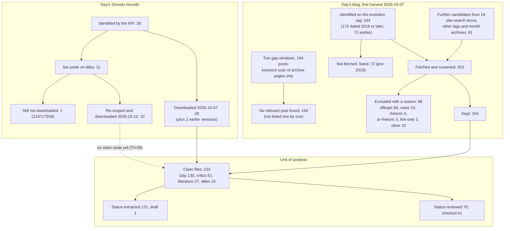

# AMSTAR 2 and ROBIS appraisal, 2026-10-12: the audit judged as a systematic review

*Criticality layer, component iii. State appraised: branch `research` at commit `ee0432e` (325 commits, 2026-10-07 18:09 to 2026-10-12 16:33 -06:00). Earlier passes: [`METHOD-AUDIT-2026-10-12.md`](METHOD-AUDIT-2026-10-12.md) (MA-01 to MA-20) and [`triveritas-audit-2026-10-12.md`](triveritas-audit-2026-10-12.md) (TV-01 to TV-11). Findings here use the prefix `AR-`.*

**Status of this document, read first.** It was written by one Claude Opus instance launched from inside the project's own session, with the project's `AGENTS.md` loaded. That is the same AI model family that harvested the sources, extracted the claims, wrote and reviewed the checks, and wrote both earlier passes. The applier had read those passes before rating, so it was not blind, and it is not an independent party. ROBIS says its users "are likely to need both subject content and methodological expertise" (RB-K3) and speaks of "review authors completing assessments independently" (RB-K4); here there is one rater and no second opinion. Every rating below is a self-assessment that an outside appraiser has yet to check (AR-13).

**No verdict, rule, vocabulary, claim file, check script or front-page text was changed.** This is a lens, not a re-score.

**The instruments were built for something else.** AMSTAR 2 calls itself "a critical appraisal tool for systematic reviews that include randomised or non-randomised studies of healthcare interventions, or both" (AM-00). ROBIS "is designed to assess the risk of bias in reviews with questions relating to interventions, aetiology, diagnosis and prognosis" (RB-00). This project reviews a body of claims (Day's, his critics', the cited literature) and adds computational checks of its own. Most items therefore apply by analogy, and each analogy is stated. Where an analogy can fairly be read two ways, both readings and both ratings are given (the spirit of rule RD), and the overall rating is reported under each.

Quotes with an id `AM-…` or `RB-…` are verbatim from the fetched instruments ([`sources/quotes-literature.md`](../sources/quotes-literature.md), section "Criticality pass iii quotes"; 77 quotes, machine-checked). Counts marked "measured" were taken by script in this pass from claim-file front matter, the three `bib-*.md` files, the three harvest logs and `git log`. Nothing was re-run or re-derived.

---

## Executive summary

**AMSTAR 2 overall confidence: critically low on the mapping this pass was asked to use; low on the instrument's literal wording. No reading gives high.**

- On the mapping "meta-analysis = the verdict tallies and the planned R5 synthesis", three of the seven critical domains fail: **item 2** (protocol registered before the work), **item 11** (synthesis method) and **item 15** (publication-bias analogue: which claims never got a check, which sources could not be read). More than one critical flaw is "critically low" (AM-B2d).
- On the literal wording, no statistical meta-analysis was conducted, so items 11, 12 and 15 do not apply. One critical flaw remains (item 2), which is "low" (AM-B2c).
- Taking the most lenient reading of every contestable item gives no critical flaw and four non-critical weaknesses: "moderate", which the instrument's own footnote would move to "low" (AM-B2e).
- Critical domains not failed: search (item 4, partial yes), excluded list (item 7, partial yes), appraisal technique (item 9, partial yes), limits considered when interpreting (item 13, yes).

**ROBIS overall risk of bias: high.** Concern is high in all four phase 2 domains: eligibility criteria (changed after the start; the book named in the project's title is excluded for want of a purchase), identification and selection (one screener per slice, one measured reversal, critics found partly through Day's own posts), data collection and appraisal (one extractor; reviewers who are not independent), synthesis and findings (vote counts over units that are not independent; no registered rule). On the most lenient reading of phase 3, where disclosure and the absence of a root conclusion are taken to answer the concerns, the overall is unclear, not low.

**What is sound, by these instruments.**
- Excluded sources are listed one by one with a reason: 99 fetched blog posts, 72 unfetched pre-2019 posts, 11 Zenodo records and the refresh exclusions (`harvest-log-day.md` l.57-240). Many published reviews do not manage this.
- The search for Day's own corpus is documented with endpoints, query terms and dates, and it went beyond the tag: 81 of the 253 screened posts were found outside the evolution tag.
- Included sources are described in detail (type, date, version, URL, sha256, access, branch; stated credentials for every commentator).
- A formal appraisal technique with explicit criteria is applied to all sides (three verdict columns, one rule).
- Limits are stated beside the results, and the audit draws no conclusion about the root claim.

**What is not.**
- The plan was not registered or publicly timestamped before the work, it was written after a first pass and contains that pass's preliminary assessments, and departures from it are not logged (AR-01, AR-02).
- Selection and extraction were done once, by one agent per slice, with no agreement measure. Ten of the eleven Zenodo records set aside on their titles on 2026-10-07 were found to be in scope on 2026-10-12 (AR-03, AR-04).
- The search is uneven across the three arms, and part of the critics' arm runs through the audited party (AR-05, AR-06).
- No flow of sources existed; some of its boxes cannot be counted from the repository as it stands (AR-07, AR-08).
- Which claims get a check has no written rule and its effect has not been analysed (AR-11). The draft synthesis rule speaks only about Day's branches (AR-12).

**What would raise the ratings** (section 7). The agent-side remedies in this file plus the existing proposals would take AMSTAR 2 to low on either mapping, and to moderate if an appraiser accepts a registered forward protocol with a deviations log as "partial yes" on item 2. Moderate is the realistic ceiling: item 2 cannot become "yes" for work already done. ROBIS can reach low concern in every domain only after the owner-dependent items: the book (domain 1), an outside second screener and reviewer (domains 2 and 3), and the right of reply, which is the analogue of contacting study authors (domain 3).

**The same instruments on the audited parties** (section 8). By the letter, Day's case and the most systematic critic rebuttals also rate critically low and high risk. That says only that a polemical book and a blog series are arguments, not systematic reviews; the instruments do not fit them and the ratings are not quality scores. A few of the underlying questions do transfer, and on those each party has something the others lack.

**Agreement with the earlier passes** (section 10). Of 16 AMSTAR 2 items and 5 ROBIS judgements, 9 agree with an MA or TV finding, 5 agree in part, 2 partly disagree (the instruments are more lenient than MA-01 and MA-17 where a formal technique and a stated limitation exist), and 5 are new. Fourteen findings are added (AR-01 to AR-14).

---

## 1. The instruments, as fetched

| Instrument | Text used | How obtained | sha256 (first 12) |
|---|---|---|---|
| AMSTAR 2, paper | Shea et al. 2017, BMJ 358:j4008 | Europe PMC full-text XML (PMC5833365). The publisher page returned HTTP 403 with a bot challenge and was not bypassed | `a38ebd064d97` |
| AMSTAR 2, checklist | The 16 items with response criteria, 4 pp. | `amstar.ca/docs/AMSTAR-2.pdf` | `318ba4139ff5` |
| AMSTAR 2, guidance | Item-by-item guidance, 8 pp. | `amstar.ca/docs/AMSTAR 2-Guidance-document.pdf` | `d08d0bb466a5` |
| ROBIS, paper | Whiting et al. 2016, J Clin Epidemiol 69:225-234 | Europe PMC full-text XML (PMC4687950) | `18be2acca11a` |
| ROBIS, tool | The form, "ROBIS 1.2 Clean", 3 pp. | University of Bristol | `6052c8cdf1ba` |
| ROBIS, guidance | "Guidance on how to use ROBIS", 39 pp. | University of Bristol | `d699009192cd` |

Full rows with URLs and hashes: [`sources/bib-literature.md`](../sources/bib-literature.md), section "Criticality pass iii"; fetch log: [`sources/harvest-log-literature.md`](../sources/harvest-log-literature.md), same section name. Each file is in its own new directory under `sources/raw/crit3-amstar-robis-2026-10-12/` (gitignored).

**Inaccessible or not read.** The BMJ publisher page (the Europe PMC XML is the same article); the BMJ web appendices (the amstar.ca guidance was used and was not compared with the paper's "Supplementary appendix 1"); the worked examples in the ROBIS guidance. **No item or signalling-question wording below is from memory.** PRISMA was not fetched: the flow in section 6 is "PRISMA-style" as a layout only.

**Rating rules relied on.**
- AMSTAR 2 names seven critical domains (items 2, 4, 7, 9, 11, 13, 15; AM-B1a to AM-B1g) and says "our listing is a suggestion and appraisers may add or substitute other critical domains" (AM-B1h). The seven were kept unchanged, so that the list was not chosen with the result in view.
- Overall confidence: high = "No or one non-critical weakness"; moderate = "More than one non-critical weakness"; low = "One critical flaw with or without non-critical weaknesses"; critically low = "More than one critical flaw with or without non-critical weaknesses" (AM-B2a to AM-B2d).
- "We strongly recommend that individual item ratings are not combined to create an overall score." (AM-B2f). No score is computed here.
- "If no information is provided to rate an item, the review authors should not be given the benefit of doubt and the item should be rated as a "No."" (AM-B2g).
- ROBIS: "If the answers to all signalling questions for a domain are "Yes" or "Probably Yes", then level of concern can be judged as low. If any signalling question is answered "No" or "Probably No", potential for concern about bias exists." (RB-K1).
- ROBIS phase 1 (relevance to a target question) is optional and was skipped: there is no overview or guideline question to match. The review question is taken from `PLAN.md`.

**How ratings are reported.** *Primary* is the rating the applier thinks an outside appraiser would most defensibly give. Where the analogy is contestable a *lenient* or *strict* alternative is added. A "partial yes" on a critical item is not counted as a critical flaw; a "no" is.

---

## 2. How the instruments map onto this project

| Term in the instruments | Analogue here | How good the fit is |
|---|---|---|
| The review | The audit: sources, quotes, claims, verdicts, tallies, and the planned R5 synthesis | Direct for the source-handling half. The computational checks are primary research by the reviewers; neither instrument covers them, and nothing below rates them |
| Research question, PICO | Whose claims (Day, critics, allies, cited literature), what kind (mathematical or empirical assertions about fixation and divergence), against what (standard population genetics as the stated null; each side's counter-claims), judged how (three verdicts) | Analogy. No intervention, comparator group or patient outcome exists |
| Included studies | Sources (rows of `bib-day.md`, `bib-critics.md`, `bib-literature.md`) and, as the unit of analysis, claims (233 claim files) | Analogy with two levels. An item can rate differently at source level and at claim level; both are given where they differ |
| Study designs | Source types: Zenodo preprints, blog posts, books, videos read through automatic captions, comment threads, forum posts, peer-reviewed papers, datasets | Analogy |
| Protocol | `PLAN.md`, plus the predictions in each check's docstring | Direct for the idea. Registration has no exact analogue; a public push with a third-party timestamp is the nearest |
| Literature search | The harvest and the refreshes (`HOWTO-refresh.md`, three harvest logs) | Direct |
| Study selection, data extraction "in duplicate" | Screening fetched items for relevance; cutting quotes and writing claim files, by two independent workers | Direct for the idea. Two agents of one model family meet the letter and not the purpose (MA-01); see AR-13 |
| Risk of bias in included studies | The appraisal of each claim: internal and fidelity verdicts under the verdict rule, the external verdict, the checks and their reviews | Analogy, and the central one. The "studies" are arguments, so their "bias" is unsoundness: a conclusion that does not follow, a citation that does not say what is claimed, an input chosen without a source |
| Meta-analysis, quantitative synthesis | The verdict tallies and scorecard on the public pages; the planned R5 synthesis | Contestable. Reading A (literal): no statistical combination of effect estimates was made, so the items do not apply. Reading B (analogy): the tallies are a quantitative synthesis by vote count. Both are rated |
| Heterogeneity | Disagreement between versions of a claim, between readings of a quote, between regimes of a simulation; the `contested` bin | Analogy |
| Publication bias | (i) Sources that exist and could not be read (paid, deleted, login-only platforms). (ii) Inside the review: which claims never got a check | Analogy; (ii) is selective examination, nearer to selective reporting than to publication bias |
| Funding of included studies | Commercial and institutional interests of the audited authors | Direct |
| Conflicts of interest of the review authors | The owner's and the model's interests and priors | Direct |
| Contacting study authors, consulting experts | Right of reply; an outside population geneticist | Direct |

**Not applicable at all:** dose, follow-up time, allocation concealment, blinding of patients (AMSTAR 2 items 8 and 9 sub-criteria); funnel plots (ROBIS 4.5 example).

---

## 3. AMSTAR 2, item by item

Fit: **D** applies directly, **A** by analogy, **A?** analogy contestable (readings given). C = critical domain. "Next level" is the smallest change that would move the rating up one step.

| # | Item (short; wording at AM-01 to AM-16) | Fit | Rating | Evidence (measured unless a file is named) | Next level |
|---|---|---|---|---|---|
| 1 | Question and inclusion criteria include the PICO components | A? | **Yes** (strict: no) | `PLAN.md` l.4-15 states the goal, the corpus ("the full lineage, from 2019 to the present"), equal treatment of both sides and the three verdicts; l.164 the unit ("One file per distinct mathematical or empirical assertion, from either side"). Strict reading: inclusion criteria are written for Day's corpus only. Critics and allies are a named watch list that grows by search (`HOWTO-refresh.md` §2.9); literature is "cited by either side" plus what a check needed (the `cited-by` column) | An "Eligibility" section with one criterion per source class and a definition of the claim unit (AR-09) |
| 2 C | Methods established before the review; deviations justified | D | **No** (lenient: partial yes) | For: a written plan with question, search rule (l.160 "depth ≤2 from seeds; keep only claim-keyword-relevant links; log every exclusion with a reason"), inclusion rule and appraisal rule (E1) was committed at `ab115bb`, 2026-10-07 18:48, before the pass-2 harvest commits (19:15 to 19:33) and the claim extraction (20:13). Against: (i) the plan was written after "R1 pass 1" and contains that pass's preliminary hierarchy, fidelity ledger and balance ledger (l.18-98); (ii) no independent verification: the first push of the branch in the owner's reflog is 2026-10-08 11:05, sixteen commits in, after the harvest, 193 claims and two rounds of checks with "verdicts merged" (`a89d06c`); (iii) the appraisal method actually used (the verdict rule, the 25% line, RH, RD, RH6) and the review tiers are not in the plan and were added after verdicts existed (MA-03, MA-14); (iv) the plan has no synthesis rule (MA-11); (v) `PLAN.md` has changed by one line since, and no deviations log exists. The guidance asks for "a written protocol with independent verification" (AM-G2a) and says "Obvious unexplained discrepancies should result in downgrading of the rating." (AM-G2c) | To partial yes: a dated protocol amendment for the remaining work and a deviations log (AR-01, AR-02). "Yes" is out of reach for work already done |
| 3 | Selection of study designs explained | A | **No** (lenient: yes) | Source types are recorded per row (`type` column; `sourcing: firsthand` 213, `secondhand` 20) and relays are handled by rule U. No text explains why comment threads, automatic captions and forum posts are admitted, or that the admitted types differ by side (Day: authored papers and posts; critics: also videos, captions and threads). Lenient reading: the dispute exists only in such venues, which the plan implies | One paragraph in the eligibility section |
| 4 C | Comprehensive search strategy | D | **Partial yes** (strict: no) | Partial-yes criteria. Two or more sources: met (Zenodo API, blog tag, site search and month archives, Substack API, YouTube listings, two Reddit archives, a Discourse API, Bluesky; Europe PMC, arXiv, Crossref). Strategy and terms given: met for Day (`harvest-log-day.md` l.21-27: the evolution, science and mittens tag pages, 19 site-search terms, four month archives; `HOWTO-refresh.md` §2). Restrictions justified: the 2019 start and the paywall rule are stated; language is not mentioned. Yes criteria. Reference lists followed: partly (Day's cited papers; in two of his papers no reference list was located, l.52). Grey literature: met. Recent: met (last refresh 2026-10-12). Experts consulted: not met (MA-10). Strict reading: the critics' arm is a target list plus two web searches, and the literature arm has no search strategy at all (AR-05) | To yes: consult content experts (O-3) and write the strategy for the critics' and literature arms |
| 5 | Study selection in duplicate | D | **No** | One agent per slice (`PLAN.md` l.161: "Each writes files only under its own subdirectory"). Triage "by keyword counts ... plus manual reading of the first ~300 characters of low-scoring posts" (`harvest-log-day.md` l.19). No second screener and no agreement figure. One measured reversal: ten of eleven Zenodo records excluded on titles were later found in scope (AR-03) | A second screener on a random sample with agreement of 0.80 or better (AM-G5, AM-G6) |
| 6 | Data extraction in duplicate | D | **No** (the quote text alone: verified by machine) | 193 claims were extracted in one commit (`ad44c23`), 39 minutes after the last harvest commit. Quotes are machine-checked as substrings of hashed raw text, which is stricter than a second reader for transcription and says nothing about which statements were chosen or how they were formalised. No sampling audit (MA-09). `parameters.yaml`: 30 entries `verified: false`, 25 `true` (MA-09). The one agreement figure (90% and 100%, `REVIEW.md` l.267) is for verdict calls, was not blind, and is not about extraction | MA-09's blind re-extraction of 30 claim files, with agreement reported (AR-04) |
| 7 C | List of excluded studies, each exclusion justified | D | **Partial yes** (claim level: no) | Listed individually with a reason: 99 fetched and excluded blog posts (reason codes: offtopic 69, news 10, rhetoric 5, ai-rhetoric 3, link-only 2, ten others once each); 72 pre-2019 posts, not fetched; 11 Zenodo records by id; 12 rows of refresh exclusions; an 8-row critics table and prose lists. Short of yes: no single list; reasons are one word with no defined vocabulary; exclusions decided on a title or a keyword scan are mixed with those decided on full text; the first critics pass gives exclusions in prose. At claim level no list exists of statements that were read and not made into claims | One generated `EXCLUDED.md` with a defined reason vocabulary and the basis of each decision (AR-07) |
| 8 | Included studies described in adequate detail | A | **Yes** | `bib-day.md` (299 rows), `bib-critics.md` (66 source rows and 102 file hashes), `bib-literature.md` (132 rows before this pass): key, type, date, title, URL, version, local path, sha256, access, branch, notes. `opponents/` has 23 profiles with side, role and stated credentials. Each claim file gives side, branch, sourcing and the quote with locator and date. Caveat recorded in the file itself: branch letters for blog rows are "keyword-count heuristics" | none needed |
| 9 C | Satisfactory technique for assessing risk of bias in individual studies | A? | **Partial yes** (strict: no) | A formal technique with written criteria exists and is applied to all sides: three verdict columns and the verdict rule. The analogues of the instrument's bias domains are covered: does the conclusion follow (internal), are inputs sourced or chosen (rule F, fidelity), do numbers match the cited source (fidelity, `parameters.yaml`), was one of several versions selected (rule SC, `ledgers/versions.md`). Short of yes: the technique was built during the review and changed after first use (MA-03, MA-14, TV-02); `holds` is the default where nobody looked (MA-07); 81 of 233 claim files carry at least one `pending` verdict; the appraisers are not independent (MA-01), which AMSTAR 2 does not ask about. Strict reading: an unvalidated instrument fitted in sight of the results is not a satisfactory technique | Proposals (a) and (f): mark unexamined verdicts, and measure the reviews' catch rate |
| 10 | Funding of the included studies reported | D | **No** | No field in any bib file, opponents profile or claim file records an interest of an audited author. The bib records that the book is sold (publisher, prices; rows `K-PZ*`) and that some critic posts are paid, as access facts only. Symmetric gap, all sides (AR-10) | An `interests` line per author from fetched text; "not stated" qualifies (AM-10n) |
| 11 C | Appropriate methods for statistical combination | A? | Reading A: **no meta-analysis conducted**. Reading B: **No** | A: the audit "states no conclusion about the root claim" (`METHODS-AND-LIMITATIONS.md`), and the comparative rates and Fisher tests were removed on 2026-10-12 (O-8). B: the front page still carries a "Scorecard so far" with verdict tallies over 233 claims. That is a vote count over units nested in authors, documents and derivation chains (MA-06), with no weights and no pre-stated rule from node verdicts to a statement (MA-11) | Register proposal (e) before R5 and replace the scorecard by its per-branch statements; add statements for the critics' side (AR-12) |
| 12 | Impact of risk of bias on the synthesis assessed | A? | A: no meta-analysis conducted. B: **Yes** | The audit re-scored every numeric claim under one rule and found its own Day-versus-critic gap "not robust" (X1); reading-dependent verdicts are counted apart; the proposals file gives the tallies under four definitions of "unexamined" (6, 24, 36 or 58) and codes the basis of 52 external verdicts. Caveat: these analyses sit beside the tallies, not in them | Apply proposals (a) and (b) |
| 13 C | Risk of bias considered when interpreting the results | A | **Yes** | README "Known gaps" (row 2: "The tallies overstate what was checked"); `METHODS-AND-LIMITATIONS.md` ("What the tallies can and cannot mean"; "The tallies across claims are not a result"); `HANDOFF.md` "Things a reader should weigh". Caveat: the discussion is prose beside pooled numbers; MA-17 stands | none needed for the rating; proposals (a) to (c) would move the caveat into the numbers |
| 14 | Heterogeneity explained and discussed | A | **Yes** (strict: no) | At node level: `ledgers/versions.md` for drift between Day's versions; readings tables under rule RD; parameter sweeps with flip values in the write-ups. At synthesis level: 114 of 172 decided external verdicts are `contested`, a bin that holds five different things (MA-08); the proposals file re-codes all 114 and the methods page discusses it. Strict reading: the explanation is in a proposal and not in the reported results | Apply proposal (c) |
| 15 C | Publication bias investigated and discussed | A? | A: no meta-analysis conducted. B: **No** | Unread sources are listed, not analysed for direction: the book, paid posts, five login-only platforms, capped comment pulls, deleted posts. Selective examination is measured only in part: MA-06 and MA-07 give check coverage by side and the count of unexamined `holds`. Measured here by the `status` field (a proxy that lags, see AR-11): 122 of 233 claim files are not `checked` or `reviewed`; Day 56 of 130 (43%), critics 37 of 61 (61%), allies 11 of 15 (73%), literature 18 of 27 (67%). Checks were ordered "by how much of ROOT each one decides" (`PLAN.md` l.181), a root that is Day's claim (MA-13). No written rule says which other claims get a check | A coverage and selection table per milestone, a written check-selection rule, and a paragraph on the likely direction of the unread material (AR-11) |
| 16 | Review authors' conflicts of interest and funding reported | D | **No** | "No conflict-of-interest statement, priors statement or licence exists yet" (`METHODS-AND-LIMITATIONS.md`, "Interests"); drafts only (`outreach/coi-and-licence-draft.md`; O-9) | The owner's statement (O-9) |

### Overall AMSTAR 2 confidence

| Reading | Critical flaws ("no" on a critical item) | Non-critical "no" | Overall |
|---|---|---|---|
| **Primary, mapping B** (tallies are a synthesis; the mapping this pass was asked to use) | 3: items 2, 11, 15 | 3, 5, 6, 10, 16 | **Critically low** |
| Primary, mapping A (literal: no meta-analysis) | 1: item 2 | 3, 5, 6, 10, 16 | **Low** |
| Most lenient reading of every item | 0 | 5, 6, 10, 16 | Moderate; low if the footnote on multiple non-critical weaknesses is applied (AM-B2e) |
| Strictest reading of every item | 5: items 2, 4, 9, 11, 15 | 1, 3, 5, 6, 10, 14, 16 | Critically low |

**Critical-domain reasoning.** Item 2 fails on every reading but the most lenient, and it is the one flaw that cannot be repaired backwards. Items 11 and 15 fail only if the scorecard counts as a synthesis. The applier's own view is that it does: a figure titled "Scorecard so far" on the front page is read as a result whatever the caveat beside it says, and R5 is planned as a synthesis. Items 4, 7 and 9 are partial, and item 13 is met, which is where the project's habits of logging and disclosure show. The rating says how far a reader can rely on the audit as "an accurate and comprehensive summary" of the material (AM-B2h); it does not say that any individual check is wrong.

---

## 4. ROBIS, phase 2 and phase 3

Answers: Y yes, PY probably yes, PN probably no, N no, NI no information. Wording at RB-1.1 to RB-C.

### Domain 1: study eligibility criteria

| # | Question (short) | Fit | Answer | Evidence |
|---|---|---|---|---|
| 1.1 | Adhered to pre-defined objectives and eligibility criteria | D | **PN** | Objectives were written before pass 2 (`PLAN.md`). Eligibility moved afterwards: social media added on 2026-10-09 ("per user scope addition", `harvest-log-critics.md` l.131); ten Zenodo records moved from out of scope to in scope on 2026-10-12; the corpus followed Day's new posts with no freeze date until O-7. The moves are dated in the logs and are not set against the plan |
| 1.2 | Criteria appropriate to the question | A | **PY** | The relevance rule (mathematics, claims or numbers on evolution, fixation and the named topics; direct replies to a critic; debate records) fits the question |
| 1.3 | Criteria unambiguous | D | **PN** | Triage is a keyword count plus a reading of about 300 characters; some posts were excluded on titles ("a judgement, not a reading", `harvest-log-day.md` l.348); who counts as critic, ally or adjacent needed a side-label rule after the fact (`opponents/keruru.md`); the claim unit is set at "a granularity the auditor chose" (methods page) |
| 1.4 | Restrictions on study characteristics appropriate (date and the like) | D | **PY** | The 2019 start matches the first presentation of the argument (`PLAN.md` l.22). Untested: the 72 pre-2019 evolution-tag posts were listed and not read. Eight posts were excluded as "rhetoric" or "ai-rhetoric" before rule RH made rhetoric a tracked category |
| 1.5 | Restrictions on sources of information appropriate (format, language, availability) | D | **N** | The book the project is named for has not been bought or read (MA-09); 20 claim files rest on it at second hand. Paid posts and five platforms are unread. The no-bypass rule is right in itself; leaving out a purchasable primary text is not an appropriate restriction. Language is nowhere stated |

**Concern: HIGH.** Rationale: criteria changed after the start without a log against the plan, are partly ambiguous, and exclude the primary text.

### Domain 2: identification and selection of studies

| # | Question (short) | Fit | Answer | Evidence |
|---|---|---|---|---|
| 2.1 | Appropriate range of sources, published and unpublished | D | **PY** | See AMSTAR 2 item 4. Known holes are listed in `HOWTO-refresh.md` (X, Gab, Telegram, SocialGalactic, Rumble and Locals unreadable) |
| 2.2 | Methods beyond database searching | D | **PY** | Citations followed from Day's texts to the literature and from Day's posts to critics; web searches for new voices; a prior-art survey (`sources/prior-art.md`) and a re-runnable gap search (`ledgers/gaps.md`). No author or expert was contacted (hard rule 6) |
| 2.3 | Search terms and structure likely to find as many eligible items as possible | D | **PN** | Day's arm: probably yes (tag walk, 19 terms, month archives of two gap windows; the search added 81 candidates to the tag's 172). Critics' arm: named targets and two web searches; Reddit by title only, so "threads whose titles omit those words are missed" (`harvest-log-critics.md` l.17); YouTube search "returned irrelevant results"; two blog searches were "inconclusive" because the site ignored the query. Several critics were found through Day's own posts (AR-05). Literature arm: no strategy; items fetched as checks needed them |
| 2.4 | Restrictions on date, format, language appropriate | D | **PY** (language: NI) | Date and format restrictions are stated with reasons. Language is not mentioned; every source is in English |
| 2.5 | Efforts to minimise error in selection | D | **N** | One screener per slice; no agreement measure; one measured reversal (AR-03) |

**Concern: HIGH.** Rationale: single-screener selection with a demonstrated error, and a critics' search that depends in part on whom Day chose to answer.

### Domain 3: data collection and study appraisal

| # | Question (short) | Fit | Answer | Evidence |
|---|---|---|---|---|
| 3.1 | Efforts to minimise error in data collection | D | **PN** (quote text alone: Y) | A structured form (`claims/_TEMPLATE.md`) and a machine check of every quote against hashed text. One extractor; no second reader checking "that no relevant information was missed" (RB-G3.1b) |
| 3.2 | Sufficient study characteristics available to authors and readers | A | **Y** | See AMSTAR 2 item 8. Full texts cannot be redistributed; URLs and hashes are given |
| 3.3 | All relevant study results collected | A | **PN** | The plan's aim "Every number in the corpus maps to a claim ID" (l.165) has never been checked. Blog comment sections "were not triaged" (`harvest-log-day.md` l.54). Results that authors have not released (the method behind FM10; a per-gene table, Q176) are held `pending`; the usual remedy, asking the authors, has not been used |
| 3.4 | Risk of bias formally assessed with appropriate criteria | A? | **PY** (strict: PN) | Formal, written, applied to all sides (AMSTAR 2 item 9). The tool is unpublished, so: "The assessor then needs to judge whether the criteria assessed were likely to identify potential sources of bias in the primary studies, given their study design." (RB-G3.4). The three-column split is likely to; rule RH6 and the default `holds` are not (MA-02, MA-07) |
| 3.5 | Efforts to minimise error in risk-of-bias assessment | D | **PN** | "risk of bias assessment should involve at least two reviewers" (RB-G3.5). By the `status` field 70 of 233 claim files are `reviewed` (24 of the 33 load-bearing), 41 `checked`, 121 `extracted`. Where a second reviewer exists it is the same model family, not blind, and the author adjudicates (MA-01) |

**Concern: HIGH.** Rationale: one extractor, no completeness check, and a second reviewer who is not independent.

### Domain 4: synthesis and findings

| # | Question (short) | Fit | Answer | Evidence |
|---|---|---|---|---|
| 4.1 | Synthesis includes all studies it should | A | **PN** | The tallies pool examined and unexamined claims (58 `holds` on files at `extracted`, MA-07) and leave out anything known only from the book |
| 4.2 | Pre-defined analyses reported, departures explained | D | **PY** for the 10 checks whose registration is verifiable; **NI** for 38 | `PREREG-STATUS.md`: 10 rows blind, with misses reported; post hoc work labelled as such; 38 rows whose order cannot be shown; 4 registered and not run. Departures from the plan itself are not logged (AR-02) |
| 4.3 | Synthesis appropriate to the questions, designs and outcomes | A | **N** | Vote counts over unlike and nested units; no aggregation rule (MA-06, MA-11, TV-06) |
| 4.4 | Heterogeneity minimal or addressed | A | **PN** | Addressed node by node; pooled into `contested` in the synthesis (MA-08) |
| 4.5 | Findings robust (sensitivity analyses) | A | **PN** for the tallies; PY for the individual load-bearing checks | The audit's own sensitivity work showed the comparative gap was not robust, and the `holds` count moves by up to 58 with the definition used. Individual checks carry sweeps, flip values, cross-host and cross-tool replication (not re-verified in this pass) |
| 4.6 | Biases in primary studies minimal or addressed in the synthesis | A | **PN** | The appraisal is the synthesis; unexamined verdicts enter it unmarked |

**Concern: HIGH.** Rationale: an inappropriate pooled presentation, with the remedy written and not applied.

### Phase 3: risk of bias in the review

| # | Question (short) | Answer | Evidence |
|---|---|---|---|
| A | Interpretation addresses all the concerns of domains 1 to 4 | **PN** (lenient: PY) | The methods page and the README's "Known gaps" address the domain 3 and 4 concerns, the unread book and the absent right of reply, and no root conclusion is drawn. They do not address single-screener selection, the route by which critics were found, the unregistered plan, the missing deviations log or the literature arm, all first set out here. The guidance allows "Yes" where concerns "were appropriately considered when interpreting results and drawing conclusions" (RB-P3a); "all" is not met |
| B | Relevance of the identified studies to the question considered | **PY** | The methods page says the work "is not yet an audit of the book" and that 26 of 52 external verdicts say what follows from the standard model, not what real genomes show (MA-05, MA-16) |
| C | Avoided emphasising results by statistical significance | **PY** | Fisher p-values were on the public pages until 2026-10-12 and were removed (O-8). A residue: `REVIEW.md` l.267 still records "p = 0.003" in the review log |

**Overall risk of bias: HIGH.** All four domains carry high concern and question A is not met for domains 1 and 2. On the lenient reading of A the overall would be unclear. No reading gives low.

---

## 5. What the two instruments credit, in one place

So that sections 3 and 4 are not read as "nothing here counts": excluded items listed with reasons (item 7); the Day-side search (item 4, 2.1, 2.2); source description (item 8, 3.2); a formal appraisal applied to every side (item 9, 3.4); limits considered in the interpretation (item 13, B); the audit's own sensitivity analysis and its withdrawal of the comparative statistic (item 12, C); ten registered runs with misses reported (4.2). Seven of the sixteen AMSTAR 2 items are yes or partial yes on the primary reading (eight with item 12, if the tallies are read as a synthesis).

---

## 6. A PRISMA-style flow of sources (first draft)

Counted in this pass from the harvest logs and bib files. "PRISMA-style" means the four boxes identified, screened, included, excluded with reasons; PRISMA itself was not fetched. Numbers in bold were re-counted by script from table rows; the others are as the logs state them.

| Arm | Identified | Screened | Included | Excluded, with reasons | What cannot be counted |
|---|---|---|---|---|---|
| Day, blog (first harvest) | 244 on the evolution tag; 81 more by search, tag and archive; 194 posts in two gap windows scanned by keyword | **253** fetched and triaged | **154** kept | **99** listed with a reason code; **72** pre-2019 listed, not fetched | How many search hits were seen and discarded before fetching. The 194 gap-window posts are not listed individually |
| Day, Zenodo | 39 records | 39 by title; 28 (later 38) by text | 28 records and 2 earlier versions on 2026-10-07; 10 more on 2026-10-12 | 11 set aside on titles on 2026-10-07 as philosophy or theology; 10 of them reversed five days later; 1 still not downloaded (Z18717939) | Nothing; this arm is fully countable |
| Day, refreshes 2026-10-09 to 10-12 | Each pass lists what it walked | In the logs, pass by pass | Bib rows added: **13, 7, 2, 2, 6**; then the Triveritas pass **24** blog, **21** Substack, **9** secondary, **7** listings | **12** table rows on 2026-10-09 and prose lists after | A single total: the passes count different things (posts, threads, records, listings) |
| Day, all | | | **299** bib rows | | The book: identified, not obtained |
| Critics and allies | 21 named targets at first harvest; per-target listings where the log gives them (McCarthy 73 posts, keruru 29, Sigma Game 100, six Reddit threads by title) | Not stated as a number | **66** source rows (48 first harvest; 10, 4, 4 in refreshes); 102 local files hashed; 23 profiles | **8** table rows on 2026-10-09 (covering more items than rows) and prose lists | **Identified and screened totals.** No per-query hit counts for the web and forum searches. Comment pulls were capped (2,000 of about 3,157 on one video) |
| Literature | No search total: items entered as cited by a party or as a check needed them | Not applicable | **132** bib rows (before the six instrument rows of this pass) | None as "excluded". By the access cell as written: about 80 full text or data obtained, 18 free but blocked by a bot challenge, 14 abstract only, 8 paywalled, 12 record only or not found | **Identified.** The number of distinct works cited across Day's and the critics' texts was never counted, so the share retrieved is unknown. At least two access cells are stale (Kimura 1962 and Kimura and Ohta 1969 were later read from owner-supplied PDFs, D-01) |
| Sources that reached a claim file | | | Lower bounds by string match of bib key or URL in claim files: Day 72 of 299 rows, critics 32 of 66, literature 22 of 110 keyed rows | | **The true numbers.** No field links a claim file to a bib key (AR-04) |
| Claims | | | **233** | No list of statements read and not made into claims | How many candidate statements were passed over |

Totals that can be stated: **497** bibliography rows before this pass (299, 66, 132); **183** individually listed exclusions on Day's side from the first harvest and first refresh (99 + 72 + 12), plus 11 Zenodo records of which 10 were reversed; **233** claim files.

---

## 7. What the ratings would become

These are the applier's forecasts, not ratings. An upgrade earned by a second agent of the same model family should be reported as such (AR-13).

| | Now | After proposals (a) to (f) are applied | After the agent-side remedies in section 9 as well | After the owner-dependent items as well (book O-1, right of reply O-2, outside reviewers O-3 and O-4, interests O-9) |
|---|---|---|---|---|
| AMSTAR 2 item 2 (protocol) | No | No. Proposal (e) registers the synthesis rule going forward; the history is unchanged | Partial yes for the remaining work if a dated amendment and a deviations log exist (AR-01, AR-02); the first five days stay unregistered | Same. An outside party holding the frozen protocol would supply the independent verification the guidance asks for |
| Item 4 (search) | Partial yes | Partial yes | Partial yes, firmer (AR-05, AR-06) | Yes: experts consulted, the book read |
| Item 7 (excluded list) | Partial yes | Partial yes | Yes (AR-07) | Yes |
| Item 9 (appraisal technique) | Partial yes | Partial yes, firmer: (a) marks what was not examined, (f) gives a catch rate | Partial yes | Yes if outside raters appraise a sample and agree |
| Item 11 (synthesis), mapping B | No | Yes by analogy, if (e) is registered before R5 and the scorecard gives way to its per-branch statements | Yes, with the critics' side added (AR-12) | Yes |
| Item 13 | Yes | Yes | Yes | Yes |
| Item 15 (publication-bias analogue), mapping B | No | No: none of (a) to (f) analyses check selection or unread sources | Yes by analogy (AR-11) | Yes; the book removes the largest unread source |
| Non-critical items | 3, 5, 6, 10, 16 are no | Same | 3, 5, 6, 10 can be met by agents (5 and 6 with the same-family caveat) | 16 met (O-9); 5 and 6 met without the caveat |
| **AMSTAR 2 overall, mapping B** | **Critically low** | Critically low (items 2 and 15) | Low (item 2), or moderate if item 2 is accepted as partial yes | **Moderate.** High would need every non-critical item at yes and an appraiser who accepts partial yes on item 2; do not plan on it |
| **AMSTAR 2 overall, mapping A** | **Low** | Low | Low or moderate, as above | Moderate |
| ROBIS domain 1 (eligibility) | High | High | Unclear: 1.1 and 1.3 answered by the amendment and log; 1.5 still no | Low once the book is read |
| ROBIS domain 2 (identification, selection) | High | High | Unclear: sample re-screening by the same family; a critics search that does not run through Day | Low with an outside second screener |
| ROBIS domain 3 (collection, appraisal) | High | High: (f) measures 3.5, it does not make the second reviewer independent | High or unclear | Low only with outside reviewers and with authors asked for unreleased results |
| ROBIS domain 4 (synthesis) | High | Low or unclear, if (a), (b), (c) and (e) are applied before R5 | Low | Low |
| **ROBIS overall** | **High** | High | High or unclear | Low becomes possible; it is for an outside appraiser to say |

---

## 8. The same instruments on the two audited bodies of work

**Read this first.** A book that argues a thesis and a blog series that answers it are arguments. Neither claims to be a systematic review, and rating either "critically low" would say only that. The instruments do not fit, and no overall rating is assigned to anyone in this section. What follows takes the handful of questions that do transfer and asks them of all three parties, on the record this repository holds. For Day that record is his Zenodo papers and blog; **the book is unread** (MA-09), so "none found" below means none in the texts held. For the critics the choice of "most systematic" is itself contestable, so two are shown: Camestros Felapton's six-part chapter-by-chapter reading of the first edition (the widest coverage of the book) and Zach Hancock's guest derivation on the Gutsick Gibbon video (the most technical; known here through automatic captions).

| Transferable question | Day's case (papers and blog held) | Camestros Felapton, six parts | Hancock, video | This audit |
|---|---|---|---|---|
| Is the question stated? (AMSTAR 2 item 1) | Yes: a count of fixations possible against a count required (Q271) | Yes: a reading of the book, chapter by chapter (`opponents/camestros-felapton.md`) | Yes: derive the neutral substitution rate and compare with observed divergence (`opponents/zach-hancock.md`) | Yes |
| Is a rule stated for choosing inputs or sources? (items 1, 4; ROBIS domain 1) | A principle is stated: "the most generous assumptions—the longest timescales proposed, the shortest generation lengths, the fastest fixation rates ever observed in any organism" (Q271). No search for those values is described in the texts held; in two papers no reference list was located (`harvest-log-day.md` l.52). Whether the inputs meet the principle is branch A of the audit and is not judged here | One text, one edition. He takes the argument as unchanged ("Day’s core argument hasn’t changed since February 2019", CA-14), which the versions ledger contradicts | Answers the version in Duffy's presentation, not MITTENS 3.0 (`harvest-log-critics.md`, "Version note") | Stated for Day's corpus; not written as criteria for critics or literature (AR-09) |
| Was the primary text read? (ROBIS 1.5) | It is his text | **Yes, the first edition.** The one party here that read the book it criticises | Not recorded in this repository | **No** (MA-09) |
| Is there a list of what was set aside? (item 7) | None found | None found | None found | Yes, for sources (partial yes) |
| Are the sources appraised by stated criteria? (item 9; ROBIS 3.4) | He criticises methods in his sources, and for the dN/dS dispute states in advance a result that would settle it his way: "If the Consortium's curated subset gives ~0.23 and our complete set gives ~0.80, then the case is closed" (Q176). His general criterion is the Triveritas (Q203) | States his own limits: "I’m not a biologist, I’m not really a mathematician" (CA-13). Concedes points to Day (CA-02, CA-10) and corrects an error of his own in the post (note to CA-03) | States credentials (GG-14, GG-15) and calls his calculation "back of the napkin" (GG-16) | Yes, formal; built during the work (item 9) |
| Was anything checked by a party the author does not control? (items 5, 6; ROBIS 2.5, 3.5) | For one paper: "two independent AI reviewers (Grok and Gemini) were asked to evaluate this paper ... The authors did not score their own work." (Q224). The Zenodo papers are recorded as "none peer-reviewed" (`bib-day.md` l.11). **Other-vendor raters are a step this audit has not taken** | None found | None found; a follow-up with credentialed reviewers was announced and not published as of the pull (`harvest-log-critics.md` l.12) | No (MA-01) |
| Is the method released so that others can re-run it? (ROBIS 3.3) | Mixed: the Zenodo records are open, and his arithmetic rows re-ran as predicted in check P1 (`QUEUE.md`); for "The Fourth Mechanism" the record is "no code, no mesa coordinates, no window size or dispersion statistic" (`refresh-2026-10-10.md` l.8) | Arithmetic is in the posts | Derivation is on a whiteboard that the captions do not capture | Yes: scripts, seeds, hashes; no one-command quote check (MA-19) |
| Is the synthesis explicit? (item 11; ROBIS 4.3) | Yes: one formula with named inputs. Whether it is the right formula is what the audit's branches A, B and G are about | Verbal | A back-of-envelope match of two numbers | No registered rule (MA-11) |
| Are the author's interests stated? (item 16) | Not recorded here; the book is sold (`bib-day.md`, rows `K-PZ*`); not searched for | Not recorded; not searched for | Not recorded; not searched for | No (O-9) |

**What this shows.** On the questions that transfer, no party meets all of them and each has something another lacks: Day states an input-selection principle and, for one paper, used raters from other vendors; Camestros read the book and states his own limits; Hancock states credentials and the precision of his estimate; the audit lists its exclusions and publishes its scripts. The instruments cannot rank the three, for the same reason the Triveritas pass gave: each fails first on outside checking. **Not done here:** no search was made for statements of method or interest by any of the three beyond the quotes already held, so every "none found" is weaker than it looks.

---

## 9. New findings

Severity as in the earlier passes. "Who" = agent (a Claude instance in the project), owner, or outside. "Helps" says whose position is strengthened if the finding is acted on.

### AR-01. The plan was not registered before the work, and it was written after a first pass
- **Severity:** MAJOR (a critical domain in AMSTAR 2; it cannot be repaired for work already done). **Category:** protocol.
- **Evidence.** AMSTAR 2 item 2, evidence column. `PLAN.md` l.18-19 ("Preliminary harvest (R1 pass 1 — done read-only, 2026-10-07)"; "None of it counts as recorded until it is checked against the raw source") and l.94 ("Balance ledger — where each side is strongest and weakest (preliminary)"). First recorded push of `research`: 2026-10-08 11:05 -06:00, at the sixteenth commit (`857c234`). Push times are from the owner's local reflog; no third-party timestamp exists.
- **Why it matters.** A reader cannot exclude that the scope, the branch structure and the order of checks were shaped by what the first pass had already suggested about who was weak where. MA-04 makes this point check by check; this is the same point for the review as a whole.
- **Remedy.** (i) Say so on the methods page. (ii) Write a dated protocol amendment for the remaining work: eligibility (AR-09), per-arm search (AR-05), the synthesis rule (proposal e, AR-12), the check-selection rule (AR-11). (iii) Give it an outside timestamp before R5. A deposit or registry entry is an outward action (hard rule 6), so (iii) is the owner's.
- **Who:** agent for (i) and (ii); owner for (iii). **Helps:** both; chiefly the Day side, against a plan drawn up with a first impression in hand.

### AR-02. No log of departures from the plan
- **Severity:** MAJOR. **Category:** protocol.
- **Evidence.** `git log -- docs/research/PLAN.md`: two commits, the second adding one line. Departures in practice, each recorded somewhere else and none set against the plan: review tiers (plan l.211-214: every check reviewed, "A check only counts after it passes"; practice since 2026-10-09: one combined review for most, D-06); the verdict rule, the 25% line and the wider verdict vocabulary (not in the plan); rules RH, RD and RH6 (D-04, D-13, D-14, D-15); the corpus following new posts; social media added; ten Zenodo records re-scoped; L5's tier lowered after registration (D-16); H4 and H8 replicates dropped (D-17); `uv run` (l.287) never used. `DECISIONS.md` is a decisions log reconstructed from commits, not a deviations log.
- **Why it matters.** "Obvious unexplained discrepancies should result in downgrading of the rating." (AM-G2c). Each departure may be reasonable; a reader cannot see them in one place or judge which were made with results in view.
- **Remedy.** `docs/research/PROTOCOL-DEVIATIONS.md`: plan text, what was done instead, date, commit, reason, who decided, verdicts affected. Mark the superseded lines of `PLAN.md`. Changes no rule or verdict.
- **Who:** agent. **Helps:** both.

### AR-03. Selection was done once, by one screener per slice, and one reversal has been measured
- **Severity:** MAJOR. **Category:** identification and selection.
- **Evidence.** AMSTAR 2 item 5; ROBIS 2.5. On 2026-10-07 eleven Zenodo records were listed as "philosophy/theology" and not downloaded (`harvest-log-day.md` l.57-58). On 2026-10-12 ten of them were fetched and "are no longer 'out of scope'; three of the papers make claims about evolution" (same file, l.364). That is ten reversals in eleven title-based exclusions. Of the 253 screened blog posts, 99 were excluded, 69 with the single word "offtopic"; none has been re-screened.
- **Why it matters.** The one exclusion decision that was later tested was wrong ten times in eleven. The blog exclusions were made on more text than a title, so the rate should not be carried over; it shows only that the error is not hypothetical.
- **Remedy.** A second screener on a random sample fixed by a committed seed: 40 of the 99 excluded, 40 of the 154 kept, and every exclusion made on a title alone (the remaining Zenodo record, the Kant posts, the Sigma Game titles). Report agreement; below 0.80, re-screen all. A same-family second screener is better than none and must be labelled; an outside or other-vendor screener is the real fix.
- **Who:** agent, then outside. **Helps:** the Day side most (material of his wrongly set aside), and the critic side where his excluded posts contain concessions.

### AR-04. Extraction was single-pass, its completeness is unchecked, and no field ties a claim to its source
- **Severity:** MAJOR. **Category:** data collection. Agrees with MA-09 ("Other source risks"); the completeness check and the link are new.
- **Evidence.** AMSTAR 2 item 6; ROBIS 3.1, 3.3. The plan's "Every number in the corpus maps to a claim ID" (l.165) has no check behind it. Claim files cite sources by title and URL in prose; front matter has no bib key (keys measured: `id, title, side, branch, parent, edges, load_bearing, sourcing, status, verdicts`). The flow in section 6 can therefore give only lower bounds for how many sources reached a claim.
- **Remedy.** (i) A `sources:` list of bib keys in claim front matter (a schema addition; it touches every claim file and no verdict). (ii) On a random 20 kept sources, list every number and assertion and check each has a claim or a stated reason for none. (iii) MA-09's blind re-extraction of 30 claim files.
- **Who:** agent. **Helps:** both; whichever side has more statements passed over, which is not known.

### AR-05. The search is uneven across the three arms, and part of the critics' arm runs through Day
- **Severity:** MAJOR. **Category:** identification.
- **Evidence.** ROBIS 2.3. Critics found by way of Day's own posts: keruru's domain ("Domain found via Day's blog post", `harvest-log-critics.md` l.9); Bowers ("Only Day's repost (2026-03-04) retrieved", l.16); the one substantive critique of the Triveritas, deleted by its author and known only because Day reproduces it (`harvest-log-day.md` l.352). Searches that could not see: Reddit by title only; two blog searches inconclusive; YouTube search unusable. Literature arm: `bib-literature.md` grows by "cited-by" and by check need; `ledgers/gaps.md` has a re-runnable search, but over the corpus already held.
- **Why it matters.** A critic whom Day never answered, writing where the watch list does not look, is less likely to be in the corpus than one he chose to answer. The direction of that bias is unknown: he may answer the weakest or the strongest. For the literature, items fetched because a check needed them are not a sample of what the field has published on a question.
- **Remedy.** (i) A written strategy per arm with a fixed query list. (ii) One critics search that does not start from Day's posts or the watch list (general web and scholarly search on the book title, the Zenodo DOIs and the distinctive terms), every query logged with its hit count. (iii) For each load-bearing external verdict, a logged literature query in the style of the gaps ledger. Read-only searches are within hard rule 6.
- **Who:** agent. **Helps:** unknown in advance, which is the reason to do it.

### AR-06. The search cannot be re-run from one place
- **Severity:** MINOR. **Category:** reproducibility.
- **Evidence.** The strategy is spread over `HOWTO-refresh.md` (written 2026-10-09, after the main harvest), three harvest logs, `gaps.md` and 56 scripts in `research/tools/harvest/` with no run-list. Per-query hit counts are given for Day's blog searches as page counts and not at all for the critics' web searches. Some endpoints are known to be incomplete or time-dependent ("The archive API omits at least three posts that exist", `harvest-log-day.md` l.349). Dates and endpoints are recorded throughout, which is the hard part.
- **Remedy.** `sources/SEARCH-LOG.md`, one row per search: date, endpoint, query, hits, new, kept. Back-fill from the logs; append at each refresh.
- **Who:** agent. **Helps:** both.

### AR-07. No single list of excluded sources; reasons are one word; three kinds of exclusion are mixed
- **Severity:** MINOR. **Category:** selection. **Credit first:** the material exists and is unusually complete.
- **Evidence.** AMSTAR 2 item 7. Exclusions decided on full text (99), on a title (Zenodo 11, some later posts), on a date without fetching (72) and on a keyword scan of archive pages (194, not listed) sit in different sections with no label for the basis. Eight posts were excluded as "rhetoric" or "ai-rhetoric" on 2026-10-07, two days before rule RH made rhetoric something the audit records.
- **Remedy.** Generate `sources/EXCLUDED.md` from the logs: item, date, arm, basis of decision (full text, title, date, keyword scan), reason from a defined list. Re-screen the eight rhetoric exclusions under rule RH.
- **Who:** agent. **Helps:** both.

### AR-08. No flow of sources existed, and three of its boxes cannot be filled
- **Severity:** MINOR. **Category:** reporting.
- **Evidence.** Section 6. Not countable today: critics identified and screened; literature identified; sources that reached a claim.
- **Remedy.** Generate the flow by script at each refresh (with AR-06 and AR-04 the missing boxes become countable).
- **Who:** agent. **Helps:** both.

### AR-09. Eligibility is written as a criterion for one of three source classes
- **Severity:** MINOR. **Category:** eligibility.
- **Evidence.** AMSTAR 2 items 1 and 3; ROBIS 1.3, 1.4, 2.4. No written criterion for which critics and allies qualify or for which literature is in; no statement on language; the 2019 start is stated with its reason but the 72 earlier posts were never looked at; no reason given for admitting captions, comments and threads.
- **Remedy.** An eligibility section in the protocol amendment (AR-01). Optionally read the titles and first paragraphs of the 72 pre-2019 posts for an earlier form of the argument, and log the result.
- **Who:** agent. **Helps:** both.

### AR-10. The interests of the audited authors are not recorded
- **Severity:** MINOR. **Category:** reporting. New; MA-19 covers the audit's own interests only.
- **Evidence.** AMSTAR 2 item 10. `opponents/*.md` record "Stated credentials"; nothing records sales, paid subscriptions, employers or institutional ties for anyone on any side.
- **Remedy.** An `interests` line per profile and for Day's venues, taken only from fetched text, with "not stated" allowed (AM-10n). This is description, not a verdict, and it must be done for every side at once.
- **Who:** agent. **Helps:** readers. It can be misused by either side as ad hominem; the line must carry no inference.

### AR-11. Which claims get a check has no written rule, and the effect has not been analysed
- **Severity:** MAJOR. **Category:** synthesis; the publication-bias analogue. Agrees in part with MA-06, MA-07, MA-13; the selection analysis is new.
- **Evidence.** AMSTAR 2 item 15. By the `status` field: Day 43% not checked, critics 61%, allies 73%, literature 67%; eight of the 33 load-bearing nodes are at `extracted` (B, B2b, E5, E6, F1a, ROOT-M, ROOT-FM, ROOT). **The field lags:** B is `extracted` and has been re-scored by a check, so these figures overstate the unexamined share and are the only countable proxy. The plan orders checks "by how much of ROOT each one decides"; since 2026-10-10 the queue has followed Day's new posts (MA-11). Unread sources are listed with no view on which way they would push.
- **Why it matters.** A side whose claims are checked more often collects more error verdicts and more confirmed ones. The audit has said this of its error rate (MA-06) and has not yet said it of its coverage as a design choice.
- **Remedy.** (i) A coverage table at each milestone: side by branch by status by load-bearing. (ii) A written rule for which claims get a check, added to the protocol amendment. (iii) One paragraph on the likely direction of the unread material, stating where it is unknown. (iv) Bring the `status` field up to date.
- **Who:** agent. **Helps:** the critic side on coverage (their claims are examined less, so "holds" means less for them); the Day side on (ii), against a queue that chases him.

### AR-12. The draft synthesis rule has statements for Day's branches only and no grading of confidence
- **Severity:** MAJOR. **Category:** synthesis. Agrees with MA-11 and MA-13; the asymmetry in the draft is new.
- **Evidence.** AMSTAR 2 item 11; ROBIS 4.3. Proposal (e) in `METHOD-AUDIT-proposals.md` lists admissible statements "per branch X" that are all about "Day's argument on branch X", and statements about ROOT. It has none of the form "the critics' reply on X fails internally" or "is supported by data", though 61 critic and 15 ally claim files exist. It has no scale for how sure a statement is. It is unregistered.
- **Remedy.** Extend proposal (e) with mirror statements for the critics' thesis on each branch and a three-level confidence note per statement, tied to `external_basis` (proposal b) and to the tier of review. Register before R5, under the rule-freeze procedure.
- **Who:** agent drafts; owner approves. **Helps:** the Day side (the standard is seen applied to his critics in the conclusion, not only in the nodes).

### AR-13. This appraisal is one rater of the same model family, not blind
- **Severity:** CRITICAL for the standing of this document only. **Category:** independence; as MA-01 and TV-11.
- **Evidence.** The status paragraph at the top. Both instruments also let a second same-family agent satisfy "two reviewers" on paper (items 5 and 6; ROBIS 2.5, 3.1, 3.5), which MA-01 says is not independence. An upgrade obtained that way would be a rating artefact.
- **Remedy.** An outside appraiser, human or other-vendor, re-applies both instruments from the fetched texts, and the two sets of ratings are printed side by side. Until then, report every duplicate-work upgrade with its same-family label.
- **Who:** owner, outside. **Helps:** both.

### AR-14. Three statements still disagree with the methods page
- **Severity:** COSMETIC. **Category:** documents and practice; new instances under MA-20.
- **Evidence.** `README.md` l.256 says the rule's application was "checked blind"; the methods page says the one review designed to be blind "reported that it was not". `PLAN.md` l.211-214 describes a review regime dropped on 2026-10-09. The claim `status` field lags (AR-11). Not fixed here: the front page and claim files are outside this pass's remit.
- **Remedy.** Correct the README sentence; mark the plan lines as superseded (with AR-02); update `status`.
- **Who:** agent. **Helps:** both.

**Counts:** 14 findings. CRITICAL for the standing of this document only 1 (AR-13); MAJOR 7 (AR-01 to AR-05, AR-11, AR-12); MINOR 5 (AR-06 to AR-10); COSMETIC 1 (AR-14). By who acts first: agent 11; agent then owner 2 (AR-01, AR-12); owner and outside 1 (AR-13).

---

## 10. Concordance with the method audit and the Triveritas pass

One row per AMSTAR 2 item and per ROBIS judgement.

| Instrument finding | Against MA and TV | Result | Note |
|---|---|---|---|
| AMSTAR 2 item 1: eligibility written for one source class | none | **new** (AR-09) | |
| Item 2: plan not registered, written after pass 1, deviations unlogged | MA-03, MA-04, MA-11; TV-02 | **agrees in part**; new at the level of the review (AR-01, AR-02) | The earlier passes found the same pattern in rules and in checks |
| Item 3: source types not explained | none | **new**, minor (AR-09) | |
| Item 4: search partial; no experts; arms uneven | MA-09, MA-10 | **agrees in part**; AR-05 and AR-06 new | MA-09 found the unread book and platforms, not the route by which critics were found |
| Item 5: single screener | none | **new** (AR-03) | The method audit did not examine the harvest ("What I did not examine") |
| Item 6: single extractor | MA-09, MA-19 | **agrees**; AR-04 adds completeness and the source link | |
| Item 7: excluded list partial | none | **new** (AR-07), and a credit neither earlier pass recorded | |
| Item 8: sources well described | MA strength 2 | **agrees** | |
| Item 9: formal appraisal technique, partial yes | MA-01, MA-02, MA-07, MA-14; TV-01, TV-02, TV-05 | **partly disagrees** | AMSTAR 2 asks whether a technique covering the right domains exists and does not ask who applied it. It is more lenient here than MA-01 and TV-01. The stricter view is theirs, and the applier thinks it is the right one |
| Item 10: interests of audited authors | none | **new** (AR-10) | MA-19 is about the audit's own interests |
| Item 11: synthesis by vote count, no rule | MA-06, MA-11; TV-05, TV-06 | **agrees**; AR-12 adds the one-sided draft rule | |
| Item 12: sensitivity of the tallies examined | MA-06 (the audit's own re-score) | **agrees** | |
| Item 13: limits considered in interpretation | MA strength 1; against MA-17, TV-06 | **partly disagrees** | The instrument credits disclosure beside the numbers. MA-17 and TV-06 say the presentation still misleads. Both can be true |
| Item 14: heterogeneity | MA-08; TV-10 | **agrees in part** | |
| Item 15: check selection and unread sources not analysed | MA-06, MA-07, MA-13 | **agrees in part**; AR-11 new as a selection analysis | |
| Item 16: audit's interests not stated | MA-19 | **agrees** | |
| ROBIS domain 1: eligibility, high | MA-09, MA-11 | **agrees** on the book and the unfrozen corpus; AR-09 new | |
| ROBIS domain 2: identification and selection, high | MA-09, MA-10 | **agrees in part**; AR-03, AR-05 new | |
| ROBIS domain 3: collection and appraisal, high | MA-01, MA-09, MA-19; TV-01 | **agrees** | |
| ROBIS domain 4: synthesis, high | MA-06, MA-07, MA-08, MA-11; TV-06 | **agrees** | |
| ROBIS phase 3: overall high | MA executive judgement; TV conjunction | **agrees** | All three passes withhold reliance on the tallies and none impugns a named check |

**Counts (21 rows).** Agrees: 9 (items 6, 8, 11, 12, 16; ROBIS domains 1, 3, 4 and phase 3). Agrees in part: 5 (items 2, 4, 14, 15; ROBIS domain 2). Partly disagrees: 2 (items 9, 13). New: 5 (items 1, 3, 5, 7, 10). Rows marked agrees or agrees in part also carry new AR findings where the note says so.

**What these instruments see that the earlier passes did not:** the search, selection, the excluded list, the flow of sources, the interests of the audited authors, registration of the plan, and a deviations log. **What the earlier passes found that these instruments cannot see:** the logic of rule RH6 (MA-02, TV-08); external verdicts decided by the disputed theory (MA-05, TV-04; ROBIS question B touches it); verdicts ahead of the like-for-like test (MA-12); the mirror tree (MA-13); category leaks (MA-15); budget deciding depth (MA-18); the audit's lack of predictions about itself (TV-03); fairness to named people, of which the instruments see only "consult experts" and "contact authors". **No earlier finding is closed by this pass.** None is contradicted; on two (MA-01 by way of item 9, MA-17 by way of item 13) the instruments are more lenient than the earlier passes.

---

## 11. Remediation, split three ways

**No-decision fixes** (change no rule, vocabulary or verdict; agent). Deviations log and superseded-line marks (AR-02). Consolidated excluded list and generated flow (AR-07, AR-08). Search log (AR-06). Per-arm search strategies and the independent critics search (AR-05). Second-screener sample with a committed seed (AR-03). Extraction completeness sample and the `sources:` field (AR-04). Eligibility text (AR-09). Interests lines (AR-10). Coverage table and `status` update (AR-11 i, iv). The three stale statements (AR-14). The methods page gains a paragraph on AR-01.

**Proposals** (held back, under the rule-freeze procedure). The protocol amendment as a whole, since it fixes the check-selection rule (AR-11 ii) and the synthesis rule. The extension of proposal (e) to the critics' side with a confidence note (AR-12).

**Owner decisions** (proposed as O-13 to O-15; `DECISIONS.md` was not edited by this pass).
- **O-13.** Give the amended protocol and the R5 synthesis rule an outside timestamp before R5 (a deposit or registry entry; an outward action under hard rule 6) (AR-01).
- **O-14.** Extend the outside seats already under O-3 and O-4 to a second screener and extractor for the samples in AR-03 and AR-04, and to an outside appraiser who re-applies AMSTAR 2 and ROBIS (AR-13).
- **O-15.** Keep AMSTAR 2 and ROBIS as a standing lens, re-applied to the R5 draft, or treat this as a one-off.

---

## 12. What was not examined

- No derivation, simulation or number behind any verdict. The checks are primary research and neither instrument covers them.
- The raw sources. No exclusion was re-screened and no claim re-extracted; AR-03 and AR-04 propose that and do not do it.
- The first critics harvest was read through its log, not its 102 files. The literature access split is a keyword reading of the access cells as written.
- `REVIEW.md` beyond one line; the review files; the argument map; the status board; the explainers.
- Whether the 81 claim files with a `pending` verdict or the 121 at `extracted` are truly unexamined: the `status` field is a proxy and is known to lag.
- Day's, Camestros Felapton's and Hancock's work beyond the quotes already held. No search was made for their statements of method or interest. The book is unread.
- Inter-rater agreement for this appraisal: there is one rater.
- PRISMA, GRADE and the Cochrane Handbook were not fetched and are not relied on.
